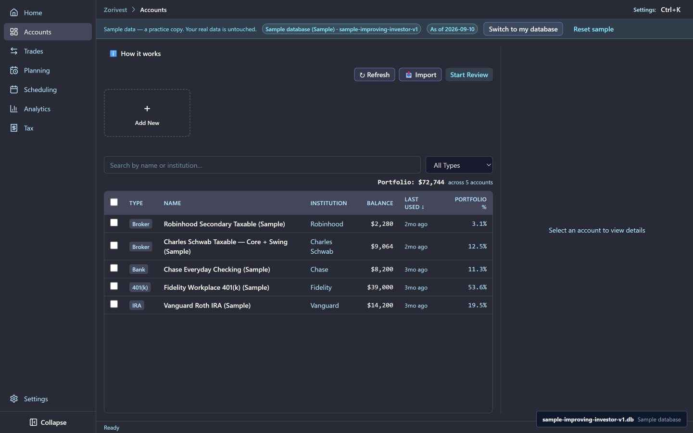
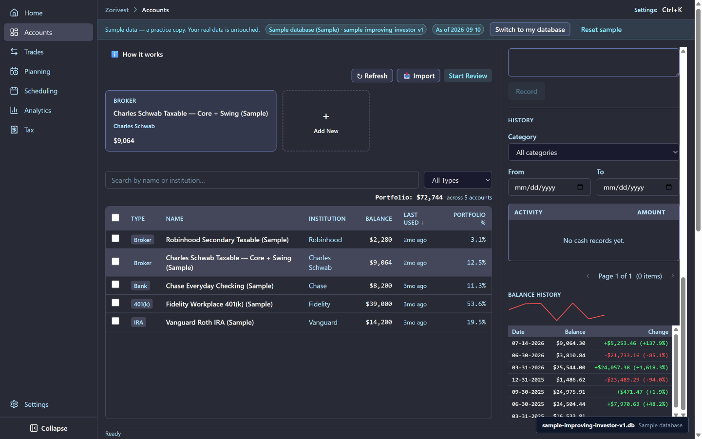
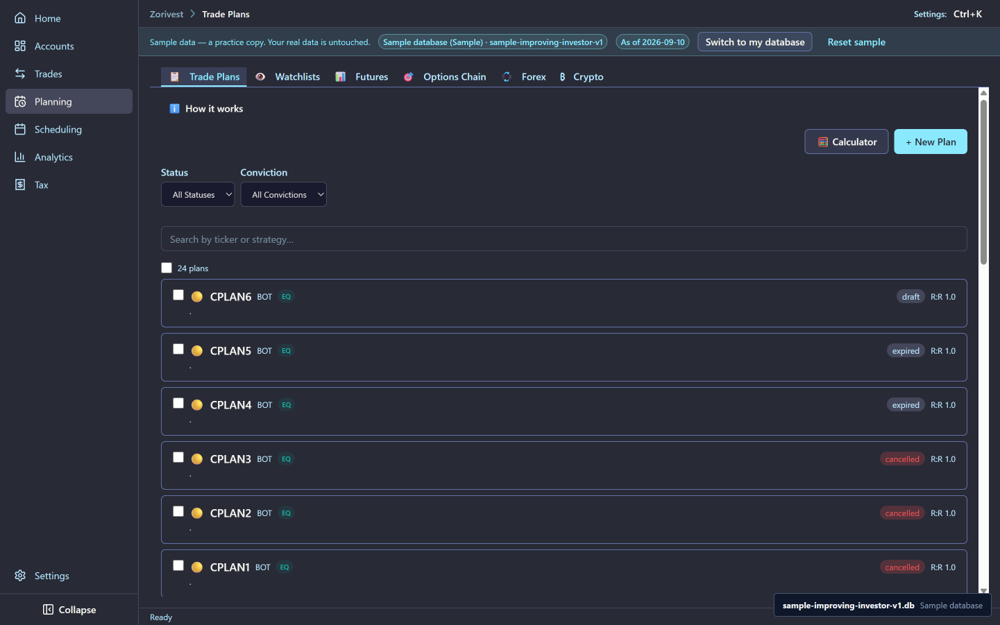

# Accounts and plans

The sample trader keeps five accounts and writes a plan before most trades. This chapter shows what each account holds, how balances are recorded, and what the plans look like.

Synthetic sample data. Not affiliated with any named institution.

## The five accounts

The accounts were entered in this order:

| Account | Role in the sample |
|---|---|
| **Chase Everyday Checking (Sample)** | A checking account; no executions |
| **Fidelity Workplace 401(k) (Sample)** | A workplace 401(k); no executions |
| **Vanguard Roth IRA (Sample)** | One execution, a DIS buy |
| **Charles Schwab Taxable — Core + Swing (Sample)** | The main trading account: 89 of the 112 executions |
| **Robinhood Secondary Taxable (Sample)** | A second taxable account: 22 executions |

Every account name ends in `(Sample)`, so sample accounts are never mistaken for yours.

<!-- from="accounts-plans-shot-list.md#1" -->

## Balance history

The sample holds 32 balance snapshots on a quarter-end grid. A snapshot records the cash an account held on that date. The cash amounts follow the ledger: they are what the executions leave in cash, not the account's ending equity, so a snapshot is not a statement of what the account was worth.

<!-- from="accounts-plans-shot-list.md#2" -->

## Trade plans

A trade plan records the entry, the stop and the target before the trade. The sample has 24 plans, and they carry four statuses:

- **Executed:** the plan was traded.
- **Cancelled:** the trader dropped the idea.
- **Expired:** the idea ran out of time. The sample has two expired plans.
- **Draft:** written but not committed. The sample has one draft plan.

Plans are what the reviews judge a trade against. A loss that stayed inside the planned risk is a different lesson from one that ran past the stop, and the [Spotlights and reviews](03-spotlights-and-reviews.md) chapter uses the plans to tell them apart. The distance from entry to stop is the trade's risk unit, R; see [R-multiples](../reference/r-multiples.md).

<!-- from="accounts-plans-shot-list.md#3" -->

## Related

- [Trades](02-trades.md) — the executions in these accounts.
- [Risk-reward ratio](../reference/risk-reward-ratio.md)
- [Guide index](README.md)
