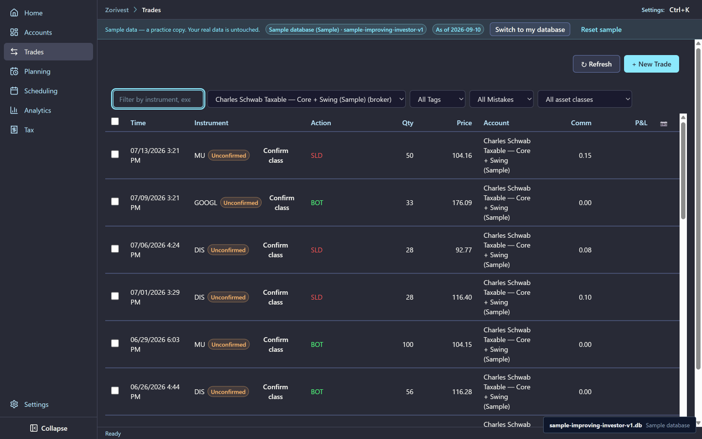
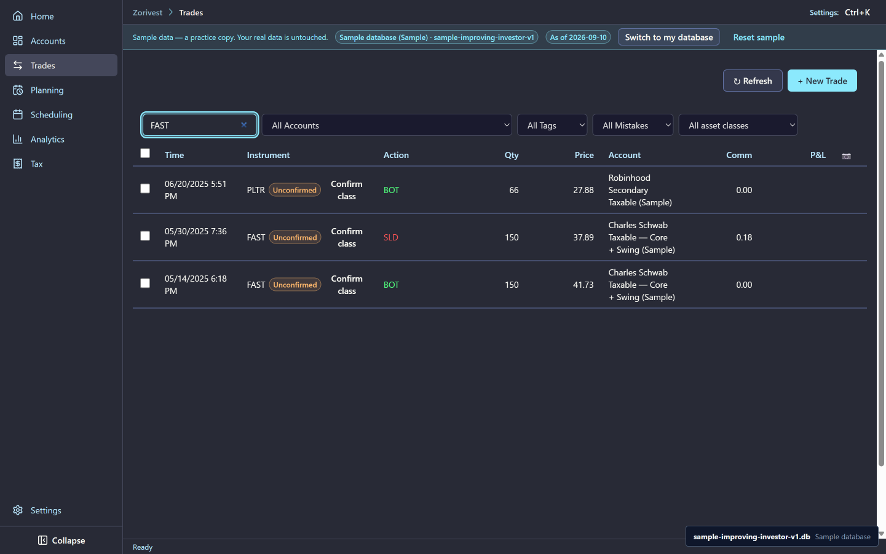
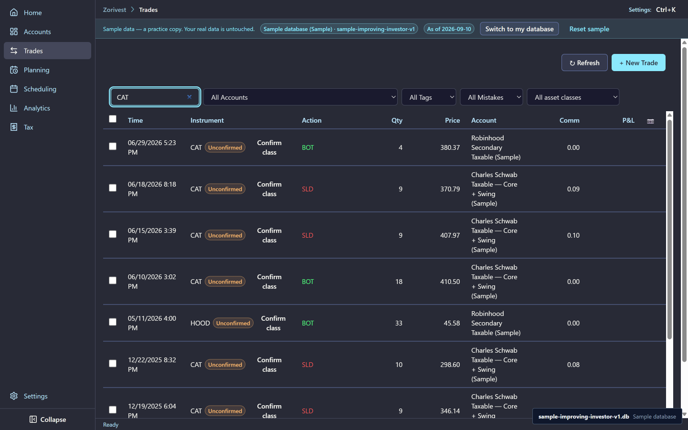

# Trades

Every fill in the sample is an execution: one buy or one sell, in one account, at one time. Zorivest groups executions into round trips and computes the results from them. Nothing in this chapter places an order; the sample is a record of trades already made.

Synthetic sample data. Not affiliated with any named institution.

## The executions

The sample has 112 executions. The Schwab taxable account holds 89, the Robinhood account 22 and the Vanguard Roth IRA 1. The Chase and Fidelity accounts hold none.

The first five executions are ex-0001 and ex-0002 (SHOP), ex-0003 (SNAP), ex-0004 (ORCL) and ex-0005 (F).

<!-- from="trades-shot-list.md#1" -->

## Entry order and ledger time

The ledger orders executions by their own time, not by the order they were typed in. In the sample, ex-0006 was entered just before ex-0005, and both keep their recorded times. Sorting by time always shows the true sequence.

## A stock split

FAST is the sample's one corporate action: ca-0001, a 2-for-1 split. The round trip that spans it starts with the entry leg ex-0026 and ends with the exit leg ex-0030. Both legs show the post-split quantity of 150 shares, so the trip's quantities line up and its result is not distorted by the split.

<!-- from="trades-shot-list.md#2" -->

## The same ticker in two accounts

Two tickers are traded in more than one account:

- **CAT** in the Schwab taxable account and the Robinhood account.
- **DIS** in the Schwab taxable account and the Vanguard Roth IRA.

Zorivest keeps each account's position separate. A buy in one account never closes a sale in another, and each account has its own round trips. The pairs still matter for tax: the [Tax and wash sales](06-tax-and-wash-sales.md) chapter shows how a buy in one account can affect a loss sold in another.

<!-- from="trades-shot-list.md#3" -->

## Tax profiles

The sample has two tax profiles, tax-2025 and tax-2026. Both file single, in Illinois, at a 24% federal bracket. The tax chapter uses them.

## Related

- [Accounts and plans](01-accounts-and-plans.md)
- [Spotlights and reviews](03-spotlights-and-reviews.md) — ten of these round trips in detail.
- [Commission](../reference/commission.md) and [cost basis](../reference/cost-basis.md)
- [Guide index](README.md)
