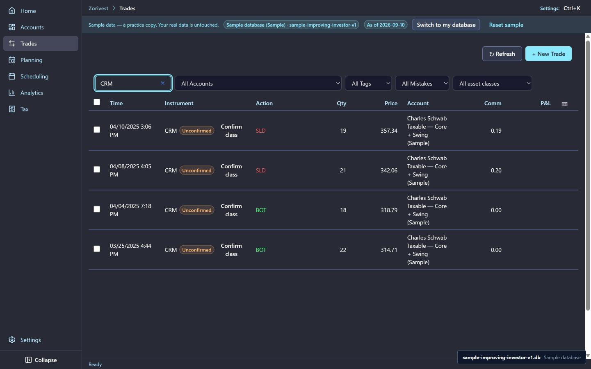
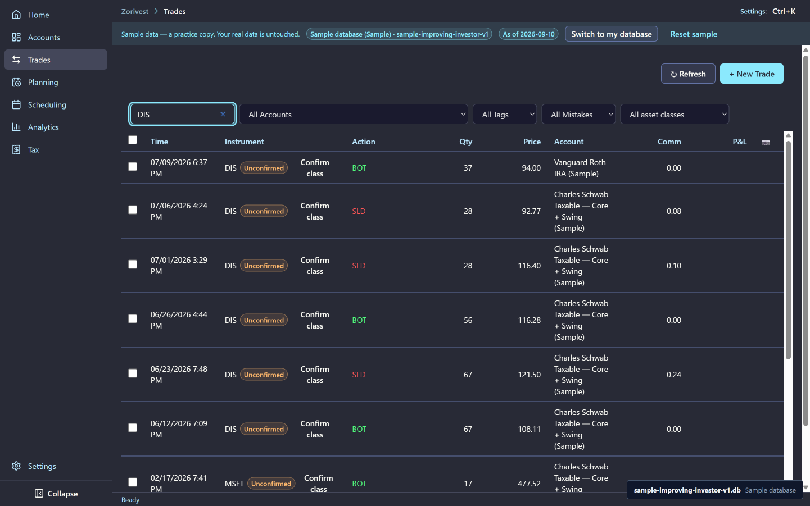
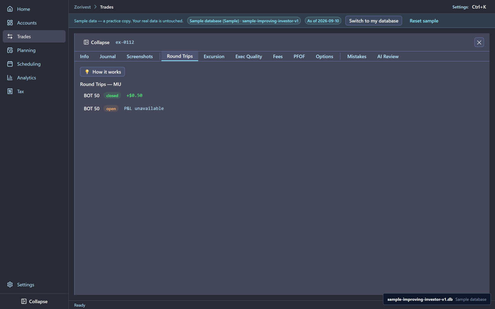
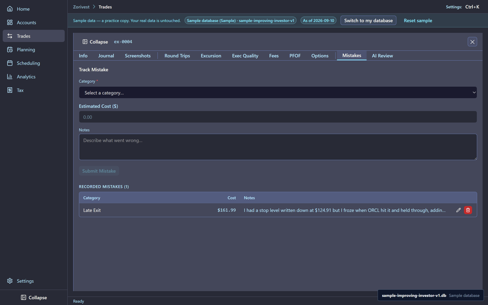
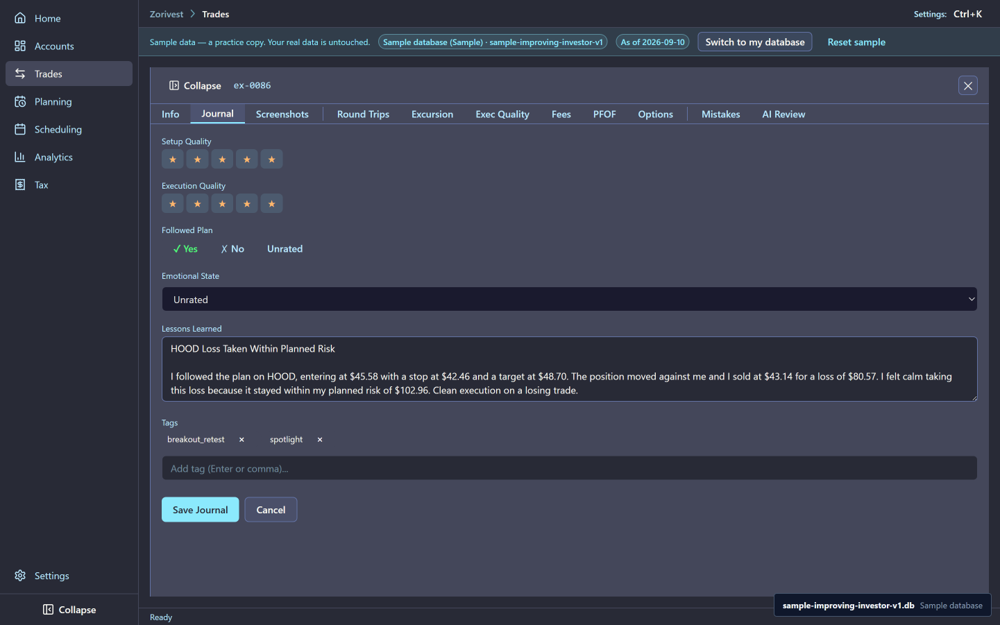
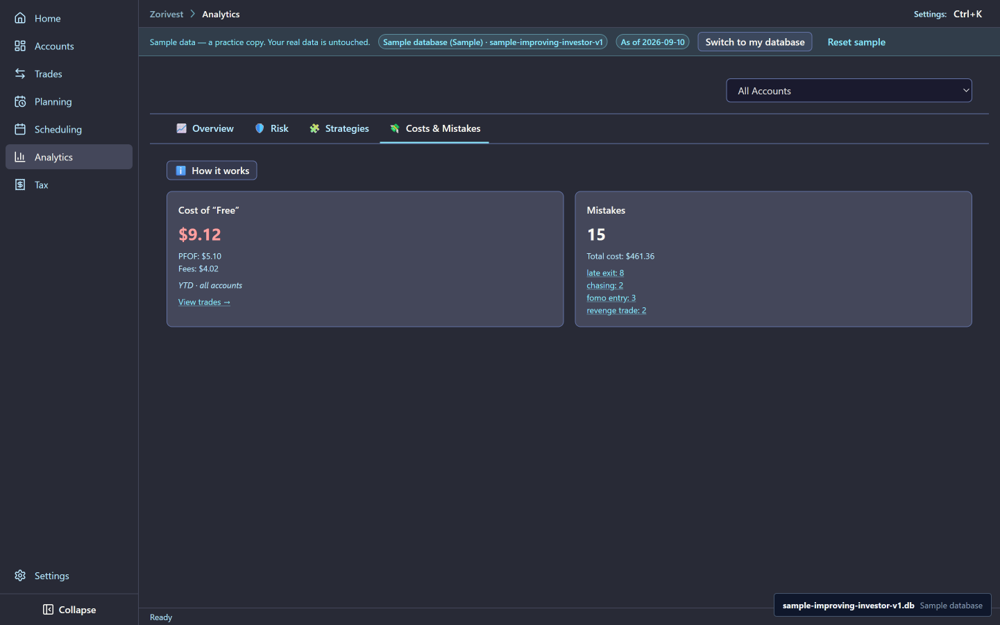

# Spotlights and reviews

Ten round trips in the sample are spotlights: each one teaches a single lesson. Beside them, the trader wrote reviews of 24 trips, and those reviews show a process that improves over the year.

Synthetic sample data. Not affiliated with any named institution.

## How results are measured

A trade's R-multiple is its net result divided by the risk to the planned stop. A loss of exactly one R means the trade lost what the plan allowed. R is only computed for closed trips. See [R-multiples](../reference/r-multiples.md).

## The ten spotlights

| Lesson | Trip | What happened |
|---|---|---|
| Planned winner | TRIP-021, GOOGL | Plan TP-0005, legs EX-0050 and EX-0051. R 1.783. |
| Disciplined planned loss | TRIP-036, HOOD | Plan TP-0013, legs EX-0086 and EX-0088. Net −80.57, R −0.783: the loss stayed inside one R. |
| Scale-in with partial exits | TRIP-006, CRM | Plan TP-0002, legs EX-0013 through EX-0016. R 1.417. |
| Partial close, open remainder | TRIP-046, MU | Plan TP-0017, legs EX-0107 and EX-0112. 100 shares bought and 50 sold; the other 50 stay open, so the trip has no R yet. |
| Same ticker, two accounts | TRIP-044, DIS | Schwab, legs EX-0105, EX-0108 and EX-0109. Net −655.10, R −1.257. The related trip is TRIP-048, DIS in the Vanguard Roth IRA, leg EX-0111. |
| Unplanned winner | TRIP-022, V | Legs EX-0052 and EX-0053, no plan. R 1.776. |
| Oversized loss | TRIP-003, ORCL | Plan TP-0001, legs EX-0004, EX-0007 and EX-0010. R −1.171: the loss ran past one R. |
| Early winner exit | TRIP-037, META | Plan TP-0014, legs EX-0089, EX-0096 and EX-0099. The average exit, 639.60, sits below the 650.60 target. R 0.815. |
| Wash-sale-linked loss | TRIP-023, CAT | Plan TP-0006, legs EX-0054, EX-0055 and EX-0056. The related trip is TRIP-024, CAT, leg EX-0057. |
| Fee-material trip | TRIP-004, F | Robinhood, legs EX-0005 and EX-0008. Zero commission; fees of 0.08 on a −62.56 gross result, the highest fee ratio of any closed trip. |

<!-- from="spotlights-shot-list.md#1" -->

<!-- from="spotlights-shot-list.md#2" -->

<!-- from="spotlights-shot-list.md#3" -->

### What the spotlights cannot show

The sample holds fills, not intraday price bars. No spotlight claims how far a trade moved for or against the position between its legs: maximum favourable and adverse excursion are unavailable. See [MFE and MAE](../reference/mfe-mae-excursion.md).

## A year of reviews

The trader reviewed 24 trips: 23 closed trips and the still-open TRIP-046. The reviews fall into three periods of eight: the first covers trips that began before July 2025, the second runs to the end of 2025, and the third is everything after. Across the periods the trader follows the plan more often and makes fewer mistakes:

| Period | Reports | Followed the plan | Adherence | Mistakes |
|---|---|---|---|---|
| First | 8 | 1 | 1/14 | 9 |
| Second | 8 | 4 | 5/14 | 4 |
| Third | 8 | 6 | 8/14 | 2 |

Adherence counts the closed, planned trips that lost no more than one R, over all closed trips in the period: 1/14, then 5/14, then 8/14. Mistakes fall from 9 to 4 to 2.

Mistakes are logged per trip, separately from the reviews, so the mistake log also covers trips that have no review.

<!-- from="reviews-shot-list.md#1" -->

<!-- from="reviews-shot-list.md#2" -->

### The mistakes

- **First period:** late exits on TRIP-001, TRIP-003 and TRIP-011; revenge trading on TRIP-009; fear of missing out on TRIP-008, TRIP-010 and TRIP-012; chasing on TRIP-004 and TRIP-014.
- **Second period:** late exits on TRIP-018, TRIP-027 and TRIP-028; revenge trading on TRIP-019.
- **Third period:** late exits on TRIP-035 and TRIP-044.

Each late exit carries its cost, from $7.57 on TRIP-027 to $161.99 on TRIP-003. Early exits are recorded on TRIP-029 and TRIP-037. No mistake record names an oversized position or a missing stop.

Each review is dated on the day of its trip's last leg. The latest is the review of TRIP-046, on 2026-07-13.

<!-- from="reviews-shot-list.md#3" -->

## Related

- [AI reviews](04-ai-reviews.md) — eight of these trips reviewed by the frozen AI reviewer.
- [Behavioral features guide](../guides/behavioral-features-guide.md)
- [Win rate](../reference/win-rate.md)
- [Guide index](README.md)
