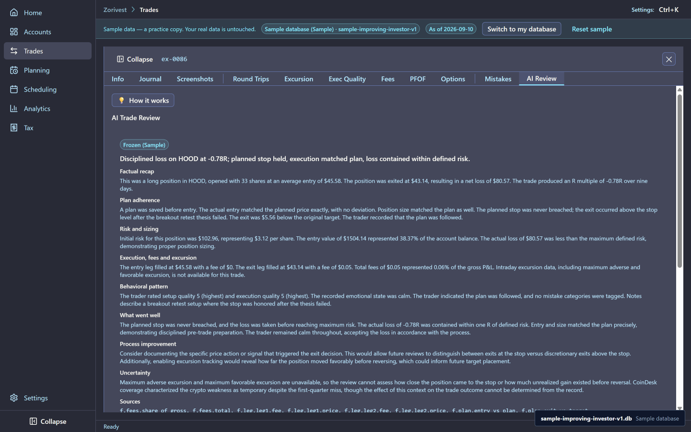
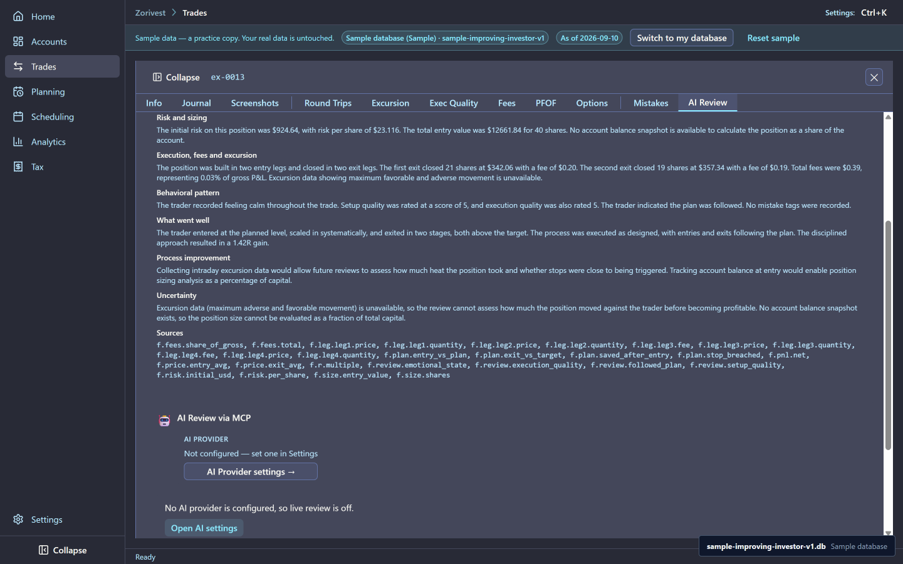
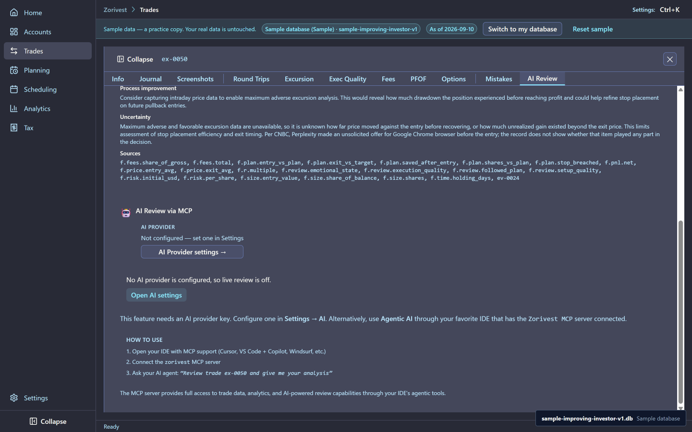
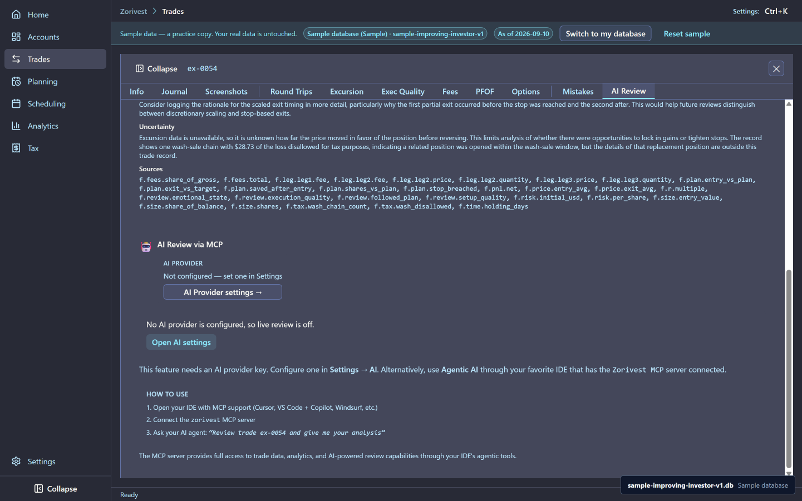
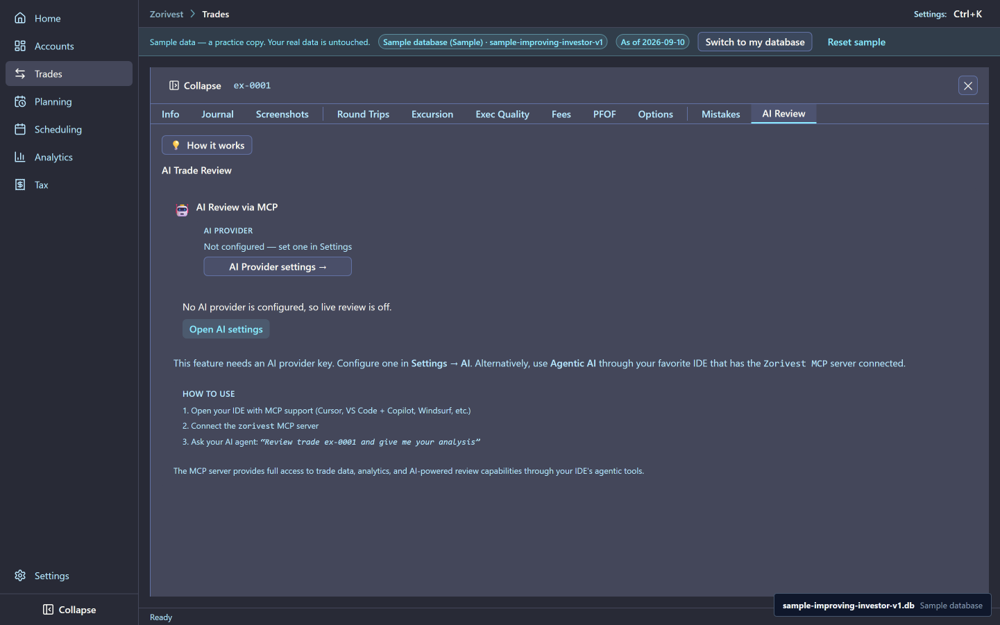

# AI reviews

Zorivest can ask an AI model to review a closed trade. The sample ships eight such reviews, already written and frozen, so you can read what a review looks like before you configure any AI provider.

Synthetic sample data. Not affiliated with any named institution.

## What a frozen review is

Each sample review is bound to its trade's sealed review bundle: the facts of the trade, its plan, its fees, the trader's own review and any cited evidence. A review may only state facts from that bundle, and a checker verified every number in all eight before they were frozen.

All eight are dated 2026-07-14 and labelled `Frozen (Sample)` on the trade's AI Review tab. They need no provider and no network, and opening one sends nothing anywhere. None of them can show maximum favourable or adverse excursion, because the sample has no intraday prices; each review says so in its uncertainty section.

<!-- from="ai-reviews-shot-list.md#1" -->

## The eight reviews

| Review | Trade | Lesson | What the review says |
|---|---|---|---|
| air-0001 | TRIP-036, HOOD | The stop held | A −0.78R loss. Entry at the plan price of 45.58 with the planned 33 shares; the exit at 43.14 stayed above the 42.46 stop. The trader recorded "calm" and that the plan was followed. |
| air-0002 | TRIP-022, V | A winner with no plan | A +1.78R gain from 304.10 to 349.40 on 19 shares. With no saved plan, the review calls the outcome good and the process unverifiable. |
| air-0003 | TRIP-006, CRM | Scale-in and partial exits | Two entries (22 at 314.71, 18 at 318.79) and two exits (21 at 342.06, 19 at 357.34), both above the 335.99 target. +1.42R; the stop was never breached and the size matched the planned 40 shares. |
| air-0004 | TRIP-003, ORCL | An oversized loss | A −1.17R loss. The exit at 123.03 was below the 124.91 stop. The size matched the planned 86 shares, so the oversize is in the loss, not the share count, and the review says so plainly. |
| air-0005 | TRIP-037, META | An early exit | A +0.81R gain. The single exit at 639.60 was 11 below the 650.60 target. The review says it cannot tell how much further the trade ran. |
| air-0006 | TRIP-023, CAT | A wash-linked loss | A −0.85R loss. The second exit (9 at 339.57) was below the 353.93 stop. The review states, as a tax-record fact and not as advice, that one wash chain disallowed 28.73 of the loss. |
| air-0007 | TRIP-004, F | Fees | A −0.64R loss on 184 shares, from 10.14 to 9.80. Fees were 0.13% of gross: the most fee-sensitive of the eight, though fees did not drive the loss. |
| air-0008 | TRIP-021, GOOGL | A well-executed winner | A +1.78R gain. Entry at the 143.27 plan price with the planned 52 shares; the exit at 159.57 was 7.16 above the 152.41 target. |

<!-- from="ai-reviews-shot-list.md#2" -->

<!-- from="ai-reviews-shot-list.md#3" -->

<!-- from="ai-reviews-shot-list.md#4" -->

## How a review reads

A review opens with a one-line verdict, then works through sections in a fixed order and ends with its uncertainty and citations. Two habits are worth noticing:

- **Outcome and process are kept apart.** The V trade made money with no plan; the review calls the result good and the process unverifiable. The HOOD trade lost money inside its plan; the review treats that as discipline.
- **Evidence is context, not a reason.** Where a news item appears, the review places it in the uncertainty section and notes that it came before the entry. It never claims the news caused the trade.

## Frozen and live

When you configure your own AI provider and run a review, the new review is labelled `Live` with the model's name, and the stored list shows the frozen record and the live record side by side. Until then, the frozen reviews are the whole story, and the review panel offers to open the AI settings instead of sending a request.

<!-- from="ai-reviews-shot-list.md#10" -->

## Related

- [Spotlights and reviews](03-spotlights-and-reviews.md) — the same trips, as the trader reviewed them.
- [Tax and wash sales](06-tax-and-wash-sales.md) — the wash chain behind air-0006.
- [Guide index](README.md)
