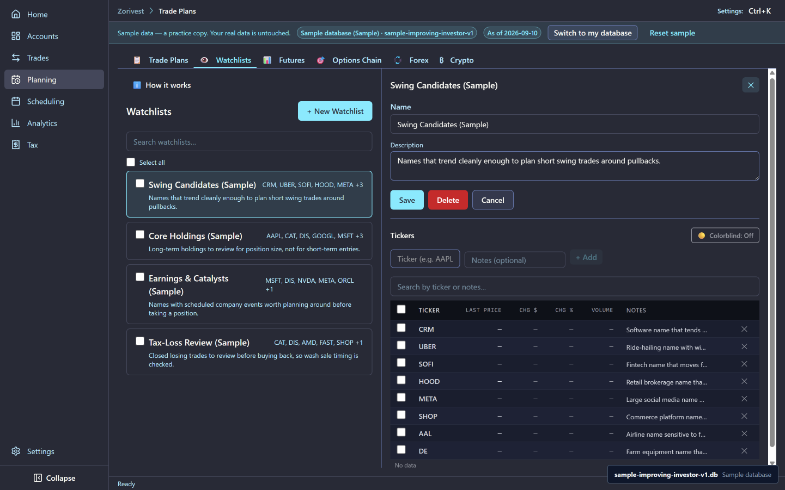
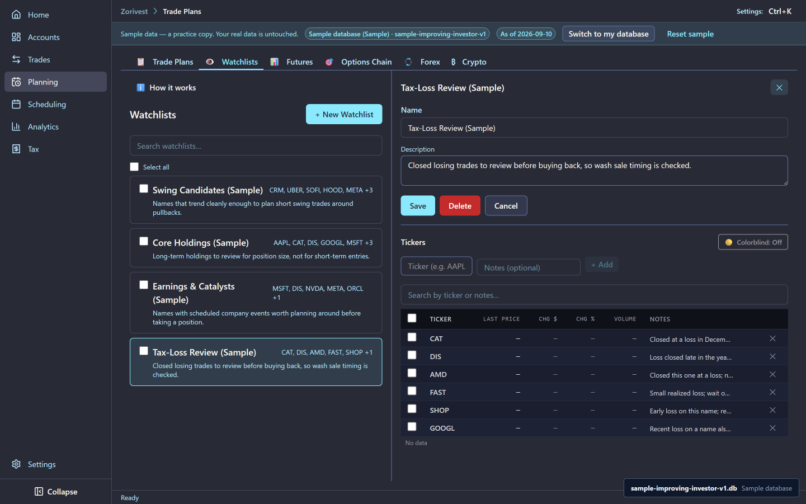
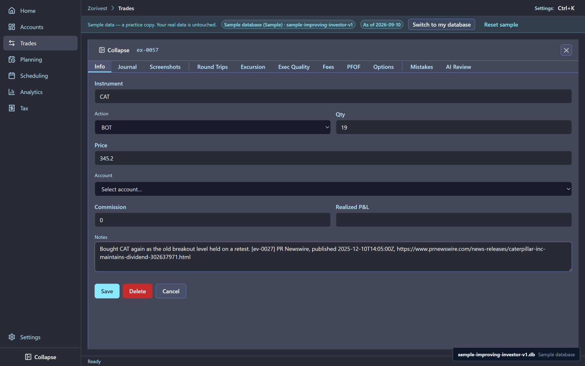

# Watchlists as a scratch pad

A watchlist in Zorivest is a scratch pad: a short list of tickers you want to keep an eye on, each with one plain note that says why. It is not a signal, a screener or a plan. This chapter shows how the sample trader uses four of them.

Synthetic sample data. Not affiliated with any named institution.

## The scratch pad model

Each watchlist item is a ticker and one plain note sentence. That is all:

- The note says why the ticker is on the list, in a few words.
- An item does not link to a plan or a trade. When an idea becomes a trade, you write a plan for it separately.
- A note holds no price, no news claim and no quote. Prices and news belong in plans, trades and reports, where their dates and sources are kept.

## The four sample lists

| List | Items | Tickers |
|---|---|---|
| **Swing Candidates (Sample)** | 8 | CRM, UBER, SOFI, HOOD, META, SHOP, AAL, DE |
| **Core Holdings (Sample)** | 8 | AAPL, CAT, DIS, GOOGL, MSFT, MU, V, XOM |
| **Earnings & Catalysts (Sample)** | 6 | MSFT, DIS, NVDA, META, ORCL, PYPL |
| **Tax-Loss Review (Sample)** | 6 | CAT, DIS, AMD, FAST, SHOP, GOOGL |

That is 28 items. Six tickers sit on more than one list (CAT, DIS, GOOGL, META, MSFT and SHOP), and each list has its own note for the ticker, written for that list's purpose.

<!-- from="watchlists-shot-list.md#1" -->

## When items were added

Items on the first three lists were added the day before the first buy in the ledger. Items on the Tax-Loss Review list were added the day after the first closed losing trade, so that list reads as a review of losses already taken: each note marks a closed loss to check before buying the ticker back. The [Tax and wash sales](06-tax-and-wash-sales.md) chapter explains why that check matters.

<!-- from="watchlists-shot-list.md#3" -->

## Where the research lives instead

The reasoning and sources behind a trade live on the trade itself. For example, the CAT entry on TRIP-024 carries its reasoning sentence followed by a citation: ev-0027 from PR Newswire, with its publication time and link. The [Analytics and evidence](07-analytics-and-evidence.md) chapter explains those citations.

<!-- from="watchlists-shot-list.md#2" -->

## Make it operational

1. Open **Planning**, then the **Watchlists** tab, and select **Swing Candidates (Sample)** to see its eight tickers, each with its note. <!-- op: 05-watchlists-scratch-pad-op-01 -->
2. Select **+ New Watchlist**, type a name for your own list, and select **Create**. <!-- op: 05-watchlists-scratch-pad-op-02 -->
3. In your new list, type a ticker and a one-line note that says why it is there, then select **+ Add**. <!-- op: 05-watchlists-scratch-pad-op-03 -->

## Related

- [Help search](../reference/help-search.md) — find the Watchlists help card's terms.
- [Guide index](README.md)
