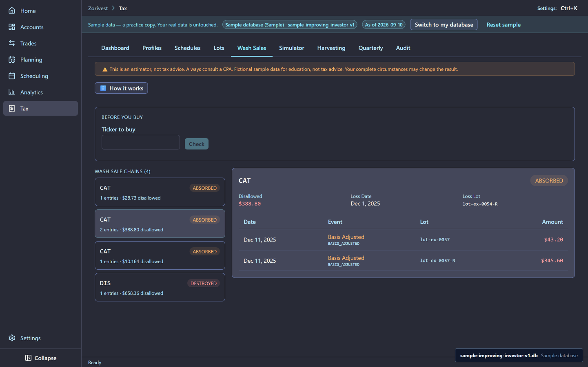
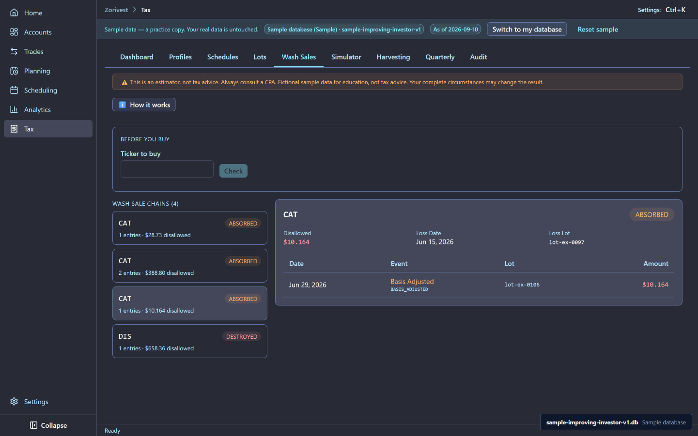
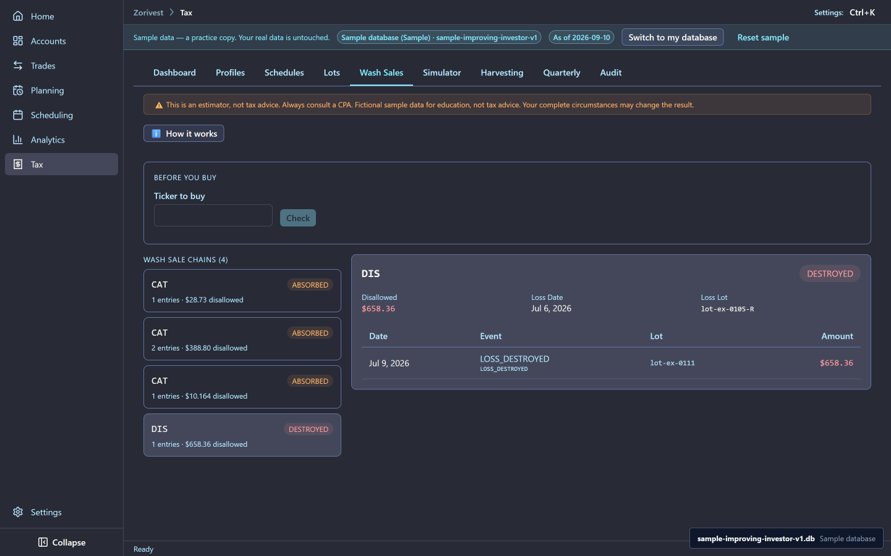

# Tax and wash sales

Zorivest tracks the tax side of each trade: realized gains and losses, holding periods, and the wash-sale rule. The sample includes five loss sales that each show a different wash-sale outcome.

Fictional sample data for education, not tax advice. Your complete circumstances may change the result.

Synthetic sample data. Not affiliated with any named institution.

## The tax profile

The sample trader files single in Illinois: a 24% federal bracket and the Illinois flat rate of 4.95%. The two profiles, tax-2025 and tax-2026, hold the same settings.

## The wash-sale rule in one paragraph

If you sell at a loss and buy substantially identical shares within 30 days before or after the sale, the loss is a wash sale. You cannot deduct it now. In a taxable account the disallowed loss moves into the basis of the shares you bought back, so you recover it when you sell them. In an IRA it is lost for good. See [Wash sales](../reference/wash-sales.md).

## The five loss sales

| Case | Ticker | Repurchase | Scope | Outcome | Realized | Disallowed |
|---|---|---|---|---|---|---|
| wash-ex-0055 | CAT | EX-0057 | Same account | Deferred | −28.73 | 28.73 |
| wash-ex-0056 | CAT | EX-0057 | Same account | Deferred | −388.80 | 388.80 |
| wash-ex-0101 | CAT | EX-0106 | Across accounts | Deferred | −22.87 | 10.16 |
| wash-ex-0103 | CAT | EX-0106 | Across accounts | Allowed | −357.48 | 0.00 |
| wash-ex-0109 | DIS | EX-0111 | Into a Roth IRA | Permanent | −658.36 | 658.36 |

**Deferred.** The disallowed loss moves into the repurchase's basis. EX-0057 gains 28.73 and 388.80 of basis; EX-0106 gains 10.16.

<!-- from="tax-shot-list.md#1" -->

**Across accounts.** The rule looks across all your accounts, not just one. The CAT buy in the Robinhood account was only four shares, so it covers part of the Schwab sales: the first sale's loss is partly disallowed ($10.16), and the second sale's loss stays deductible.

<!-- from="tax-shot-list.md#2" -->

**Permanent.** The DIS replacement shares were bought in the Vanguard Roth IRA. Because the repurchase sits in an IRA, there is no basis to carry the loss into: 658.36 is lost for good.

<!-- from="tax-shot-list.md#3" -->

Three other sales also match a repurchase but were gains, so they are not wash sales: wash-ex-0076 (MSFT), wash-ex-0104 and wash-ex-0108 (DIS). None of these cases changes the trade ledger; the wash-sale treatment is a tax record on top of it.

## Examples the ledger cannot show

Some lessons need trades the sample does not have, so they appear as worked examples only:

- **Long-term holding.** A lot held more than one year is long-term. No lot in the sample is held that long.
- **FIFO versus specific identification.** The CRM trip's two sales, EX-0015 and EX-0016, split their gain 574.15 / 736.34 under first-in, first-out and 500.71 / 809.78 under specific identification. The trip total is 1310.49 either way. See [FIFO and LIFO](../reference/fifo-lifo.md).
- **Estimated tax.** A quarterly estimated payment just below the safe harbor. No figure is taken from the ledger. See [Quarterly estimates](../reference/quarterly-estimates.md).

Dividend-reinvestment wash sales are not included: the sample pack cannot express where a buy came from, so it cannot mark one as a reinvestment.

## Related

- [Watchlists as a scratch pad](05-watchlists-scratch-pad.md) — the Tax-Loss Review list.
- [Stored reports](08-stored-reports.md) — the quarterly tax check.
- [Capital gains and losses](../reference/capital-gains-losses.md) and [IRS Publication 550](../reference/irs-pub-550.md)
- [Guide index](README.md)
