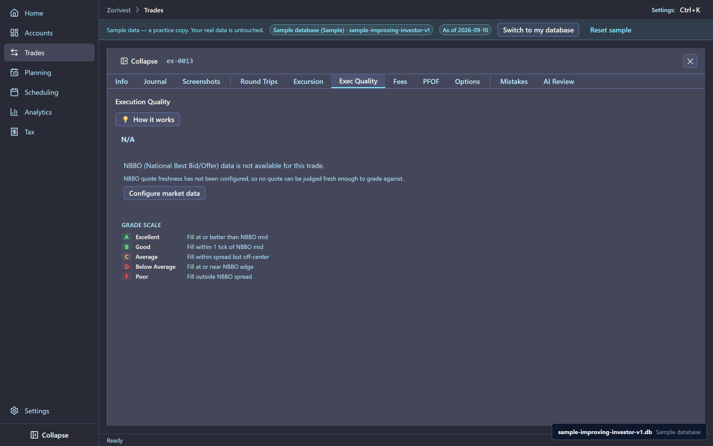
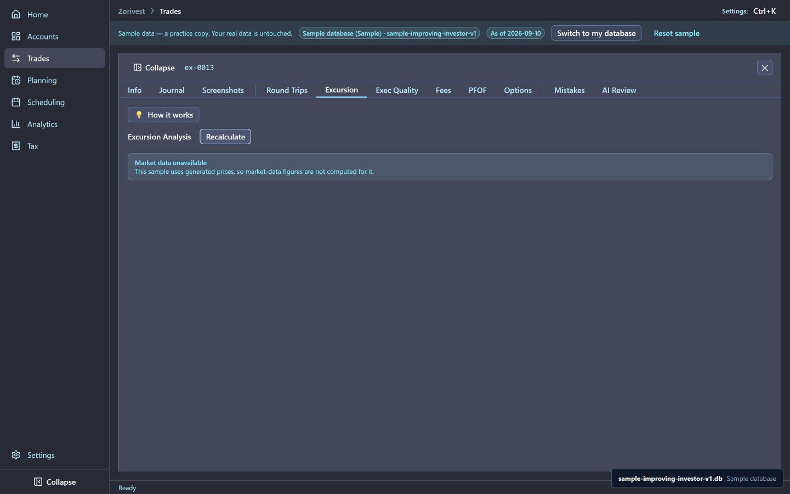
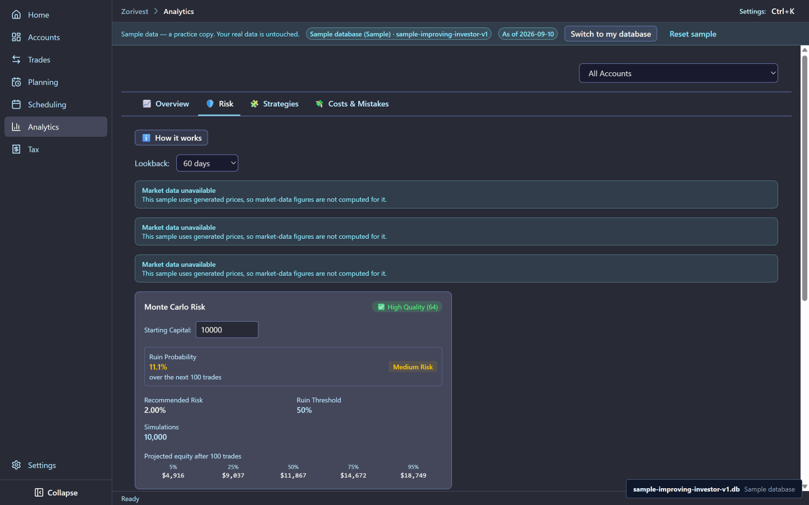

# Analytics and evidence

This chapter covers two things: what Zorivest's analytics can and cannot compute from the sample, and how the sample's trades cite the news they were based on.

Synthetic sample data. Not affiliated with any named institution.

## Strategy expectancy

The sample's closed trips belong to four strategies. Only one has enough trips for an expectancy figure:

| Strategy | Closed trips | What the app shows |
|---|---|---|
| Trend pullback | 30 | Win rate 0.5, gross expectancy 62.76, average commission 0.21, net edge 62.55 |
| Breakout retest | 7 | Counts only; too few trips |
| Legacy breakout | 3 | Raw figures only; too few trips |
| Experimental earnings gap | 2 | Raw figures only; too few trips |

Expectancy is the average result per trade. Zorivest stores it gross, before commissions. The net edge subtracts the average commission: 62.76 − 0.21 = 62.55 for trend pullback. The smaller strategies show no expectancy, so they have no net edge either. See [Expectancy](../reference/expectancy.md) and [Win rate](../reference/win-rate.md).

## What needs market data

The sample's prices are generated, not observed, and it holds no daily price bars. So the measures that depend on market data show a notice instead of a number:

- excursion (how far a trade moved for or against you),
- volatility,
- correlation,
- risk decomposition,
- risk regime.

Each reads "market data unavailable". Execution quality shows its own reason line: no NBBO provider is configured. Monte Carlo is different: it runs live on its own card each time, and is never stored. See [NBBO](../reference/nbbo.md), [MFE and MAE](../reference/mfe-mae-excursion.md) and [Monte Carlo](../reference/monte-carlo.md).

<!-- from="analytics-shot-list.md#1" -->

<!-- from="analytics-shot-list.md#2" -->

<!-- from="analytics-shot-list.md#3" -->

## Cited evidence

Every round trip in the sample records why it was made and cites at least one news item for it. The sample holds 54 evidence items across 48 trips: 48 support an entry and 6 support an exit. 42 trips cite one item and 6 cite two, and every trip has at least one.

A cited note is the trader's own sentence, then the citation: the item's id, its source, its publication time and its link. For example, the CAT entry on TRIP-024 cites ev-0027, published 26 hours before the buy. Each item's summary is original sample text; no article text is stored.

### The hindsight rule

An item may only support a decision it came before. Every item was published before the decision it supports, and on or before the sample's evidence cutoff, 2026-07-14. The smallest gap in the sample is 12 hours. Each item also records when its link was checked, which is later than the cutoff by design: it says when the sample looked, not what the trader could have known.

## Related

- [Stored reports](08-stored-reports.md) — the weekly review that embeds the strategy table.
- [Spotlights and reviews](03-spotlights-and-reviews.md)
- [Guide index](README.md)
