# Stored reports

A report policy runs on a schedule, gathers data from your journal and stores a report. The sample ships twenty stored reports already written, srp-0001 to srp-0020, so you can read every report type before you run one yourself. All twenty are labelled `Frozen (Sample)` under Scheduling, then Stored Reports.

Synthetic sample data. Not affiliated with any named institution.

## How a sample report reads

Each report opens with its title and the line "Sample report, frozen as of" its date and time, and closes with an "Activating your own version" section. Every number in a report is a claim with a source (the ledger, a plan, a watchlist, the evidence, the tax engine or a metric over the sample), and every one was checked before the report was frozen.

The sample has no daily price bars, so a report never writes a market figure as a number. Where one would go, the report says `Market data unavailable in the sample`.

<!-- from="reports-shot-list.md#1" -->

## Daily intelligence reports

Thirteen reports cover ten consecutive trading sessions, 2026-06-30 to 2026-07-14: ten **Morning Watchlist Brief (Sample)** reports and three **End-of-Day Watchlist Changes (Sample)** reports (srp-0003, srp-0009 and srp-0012).

**The morning brief.** One block per watchlist ticker it covers, and every block has the same eight fields, in order: workflow state, watchlist note, price and volume freshness, cited evidence, what changed, linked plan or position assumptions, uncertainty, and a neutral workflow step. A field with nothing to say says so in words, such as `No usable news since the prior brief`; it is never left out.

**Neutral workflow steps.** A step names something to review or re-read, for example "Review the trend pullback plan's recorded entry, stop and target". It never says buy or sell, never gives a price instruction and never names an order.

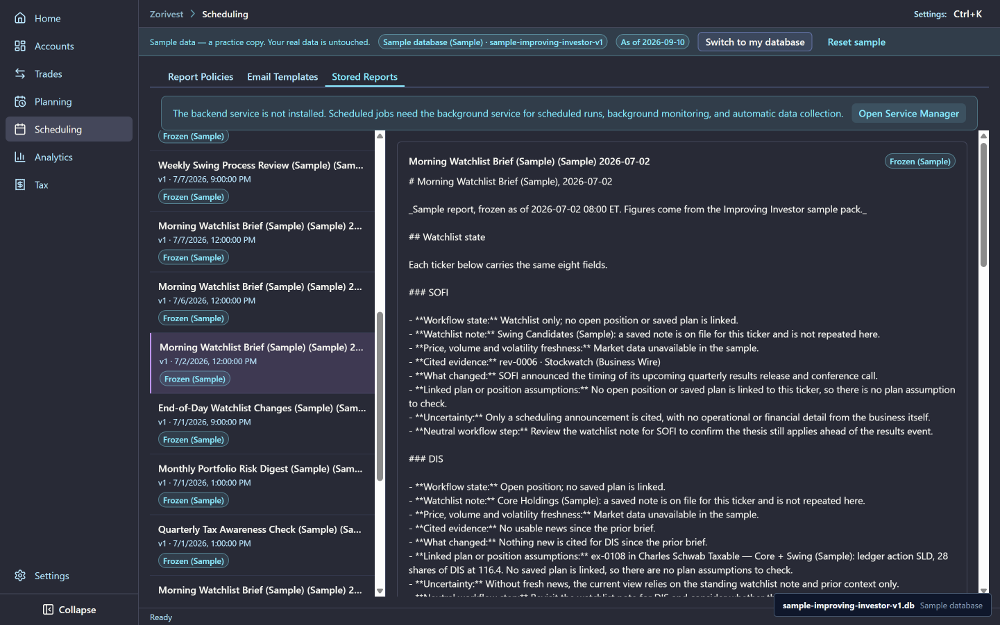<!-- from="reports-shot-list.md#2" -->

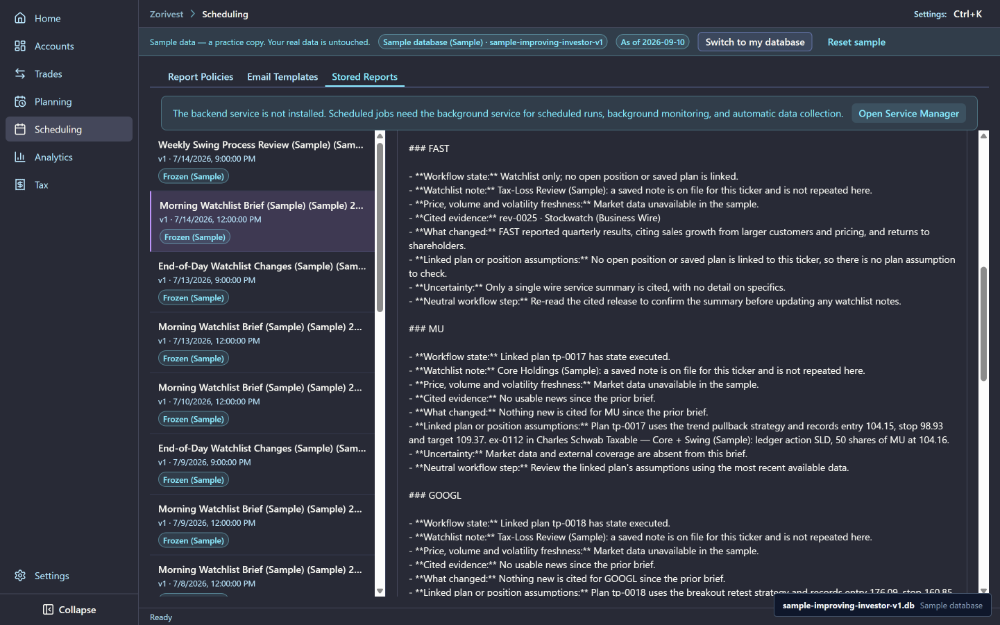<!-- from="reports-shot-list.md#3" -->

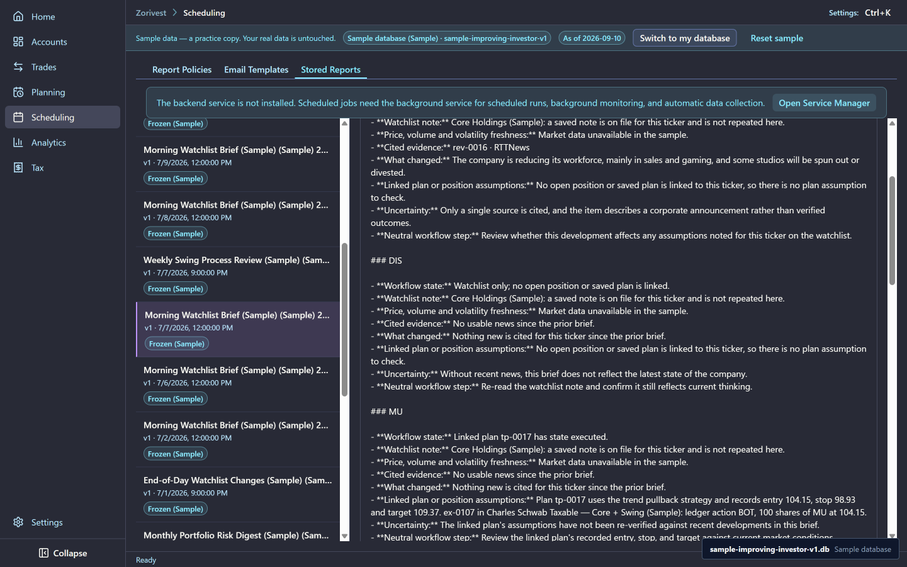<!-- from="reports-shot-list.md#10" -->

### The days worth reading

Five briefs are tagged with the kinds of news day they show, eight kinds in all:

| Brief | Date | What it shows |
|---|---|---|
| srp-0005 | 2026-07-06 | The most cited items of the ten briefs (seven): one labelled stale, the monthly employment report as the macro item, and outlets that disagree about it. |
| srp-0007 | 2026-07-08 | The day the news provider was unavailable. |
| srp-0010 | 2026-07-10 | A quiet session with no ledger rows since the prior report; its two cited items are carried over, and the brief says so. |
| srp-0011 | 2026-07-13 | No usable news: every ticker block says so, and "what changed" cites nothing new. |
| srp-0013 | 2026-07-14 | Quarterly results for FAST, and two local-station copies of one story, labelled as duplicates of each other (rev-0022 and rev-0023). |

Two other kinds of day, a ticker leaving the candidate list and a plan expiring without a trade, have no dated source in the sample, so no brief narrates them.

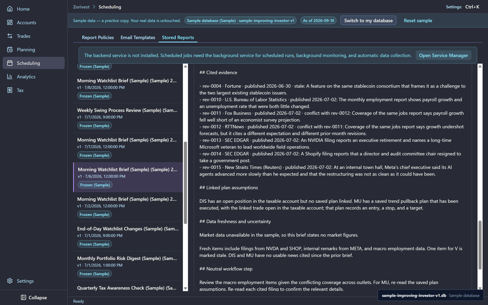<!-- from="reports-shot-list.md#4" -->

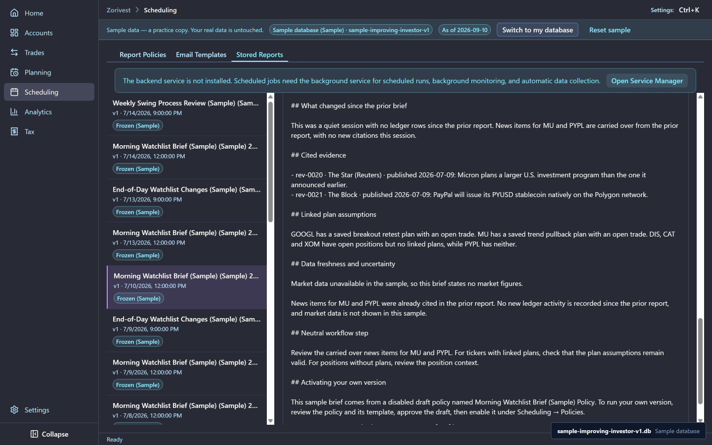<!-- from="reports-shot-list.md#5" -->

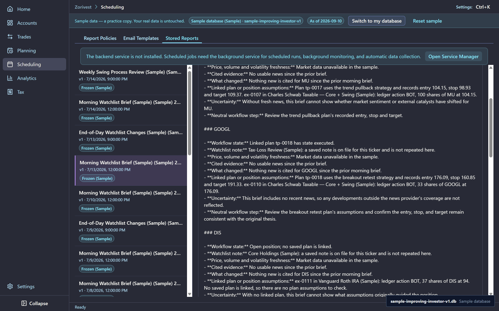<!-- from="reports-shot-list.md#6" -->

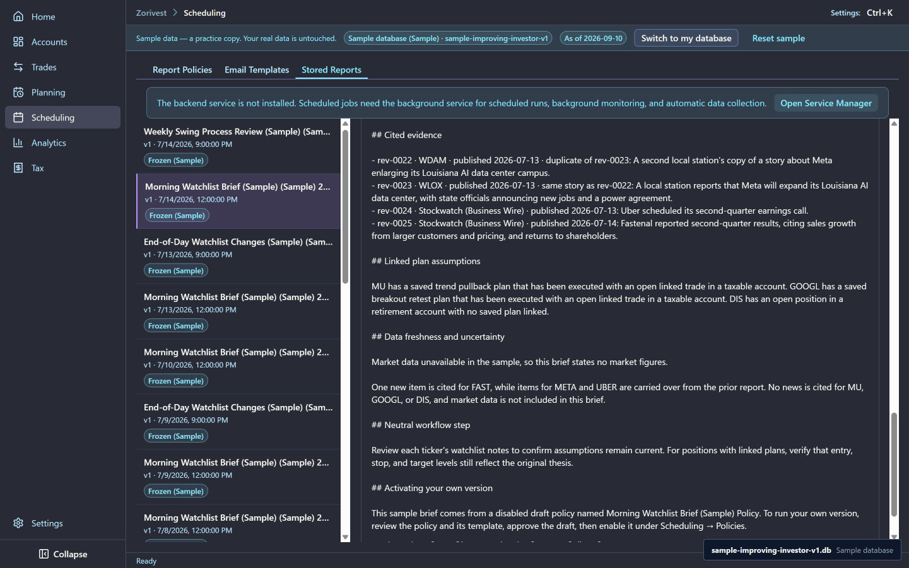<!-- from="reports-shot-list.md#7" -->

### A brief without news

On 2026-07-08 the news provider could not be reached. The brief for that day, srp-0007, is a complete stored report like the others. Every ticker block says `News provider unavailable for this brief`, the cited evidence section says that no news items are cited, and the data freshness section names both gaps: no news and no market data. Everything that does not depend on news is still there: the watchlist lines, the linked MU plan (tp-0017) with its entry, stop and target, the open CAT position, the ledger line and a neutral workflow step. This is what a report looks like when a source is down: it says what it could not fill.

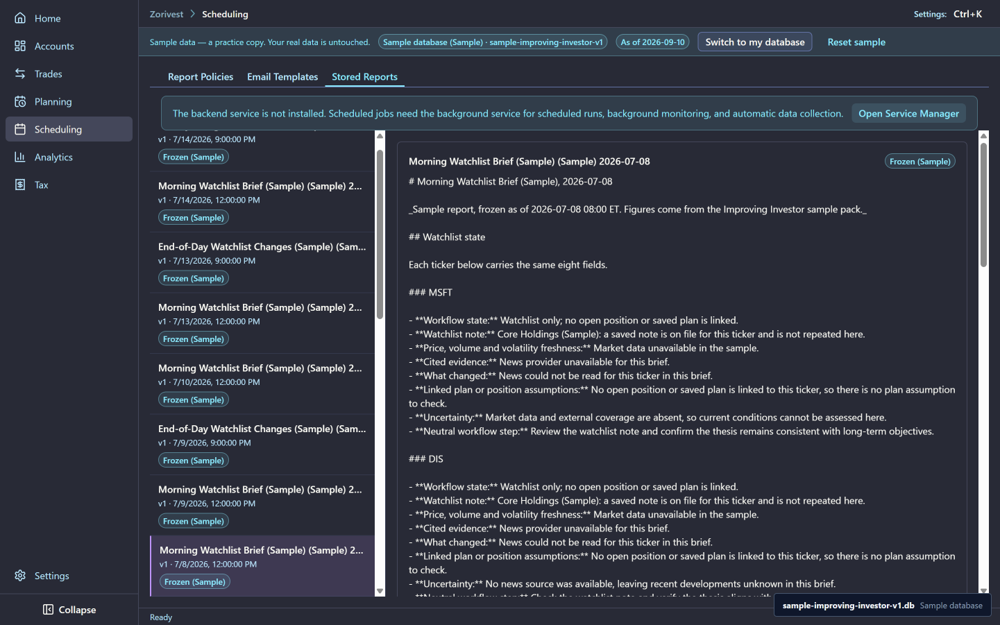<!-- from="reports-shot-list.md#8" -->

### Evidence in a brief

Evidence items appear as context, with their source name and publication date. A brief never cites an item published after the brief itself, and never cites a watchlist item before the date it was added. Every summary is the sample's own wording, not article text.

### End-of-day changes

Each end-of-day report lists the changes since the morning brief, cited evidence, plan status changes, data freshness and uncertainty, and a neutral workflow step.

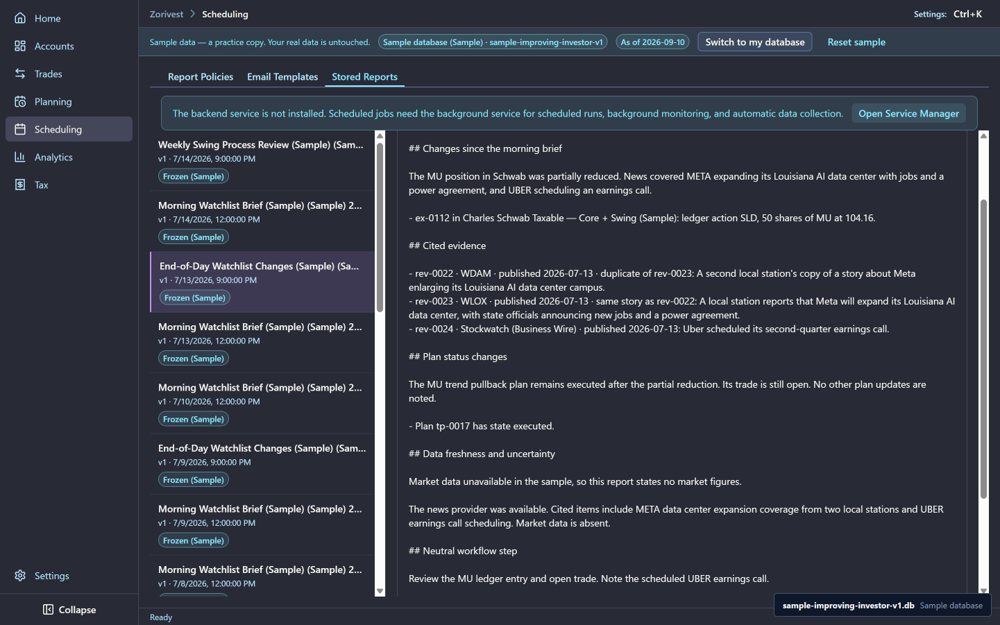<!-- from="reports-shot-list.md#9" -->

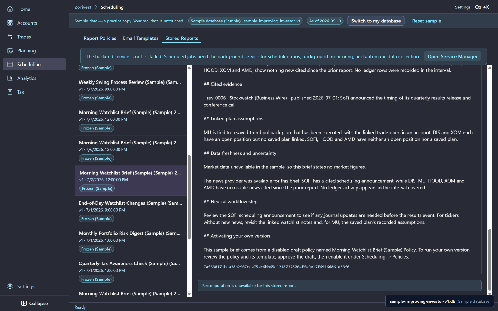<!-- from="reports-shot-list.md#11" -->

## Periodic reports

Seven reports, srp-0014 to srp-0020, look back over a week, a month or a quarter.

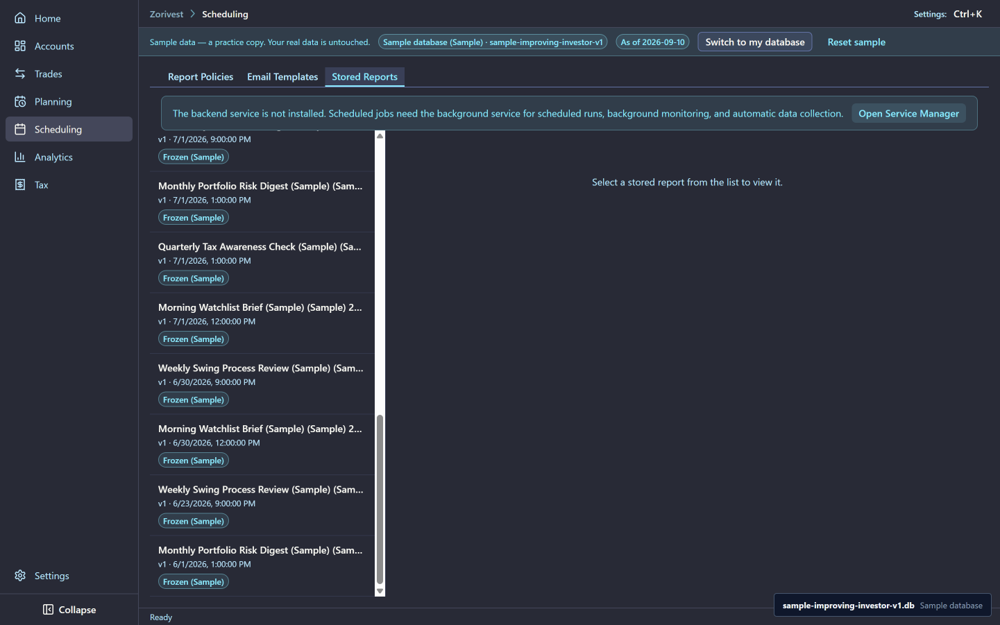<!-- from="reports-shot-list.md#13" -->

### Weekly Swing Process Review

Four weekly reviews (srp-0015, srp-0016, srp-0019 and srp-0020) cover the weeks ending 06-23, 06-30, 07-07 and 07-14. Each has round trips closed that week, plan adherence, a mistake log, process observations and the metrics it does not show.

- A week holds at most two closed trips: TRIP-040 and TRIP-042 in the first, none in the second, TRIP-044 in the third, none in the fourth. That is below the app's floor of 8 closed trips, so every weekly review says `Sample too small for expectancy` and shows no expectancy, win rate or net edge.
- A week with no closed trip says `No round trips closed in this window` and shows no adherence figure.
- Only the last review, srp-0020, embeds the strategy table, under `Strategy scenarios (Sample · frozen as of 2026-07-14)`. The earlier reviews leave it out, because the table runs to 2026-07-14 and would cite trades from after their week.

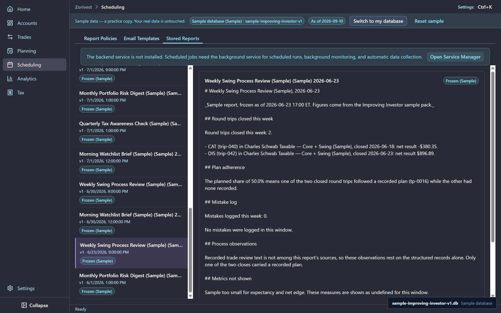<!-- from="reports-shot-list.md#14" -->

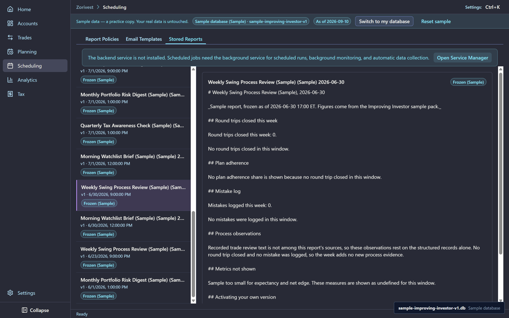<!-- from="reports-shot-list.md#15" -->

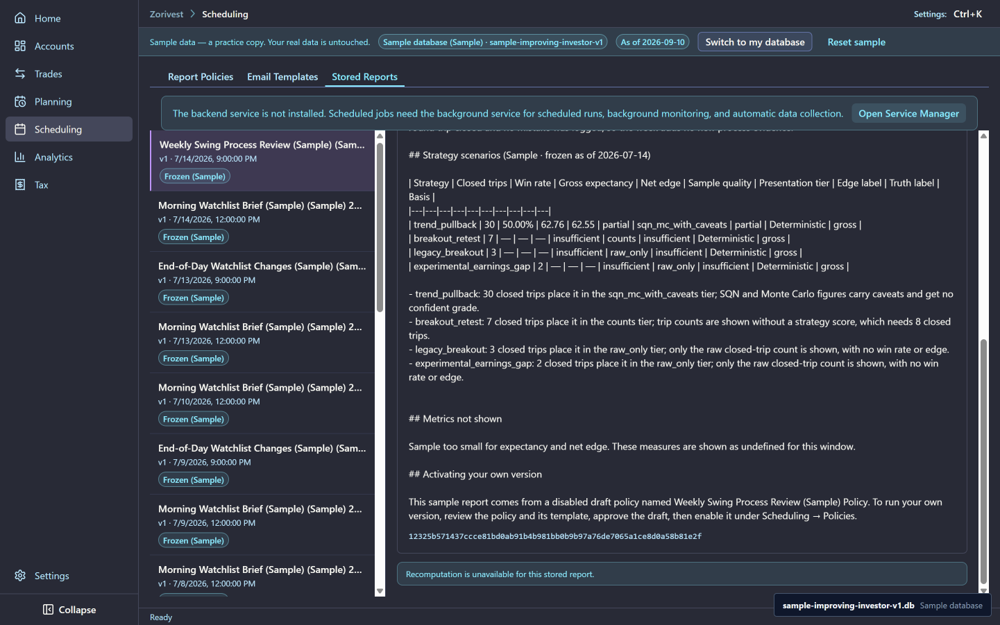<!-- from="reports-shot-list.md#16" -->

### Monthly Portfolio Risk Digest

Two monthly digests, srp-0014 for May and srp-0017 for June, each with account balances, realized results, open holdings, mistake cost and the measures not shown.

- **Account balances.** The digest says balances are not among its sources, so it shows no balance or monthly change. That is a stated absence, not an omission.
- **Realized results.** June: net realized $61.18 (all of it in the Schwab account; Robinhood $0.00). The sale of the remaining half of SHOP on 06-04 realized −$543.65. The largest realized drawdown across the taxable accounts was 4.5% of peak realized equity, a fall of $1,401.70. May's digest books the 05-28 SHOP sale on TRIP-039 at +$50.63.
- **Open holdings** are shares of open cost basis, by ticker and by account. In June: MU 41.2%, DIS 25.8%, XOM 22.2%, CAT 6.0%, NIO 4.9%; Schwab 89.1%, Robinhood 10.9%.
- **Mistake cost.** June logged none.
- **Measures not shown.** Volatility, correlation and risk contribution, named as unavailable.

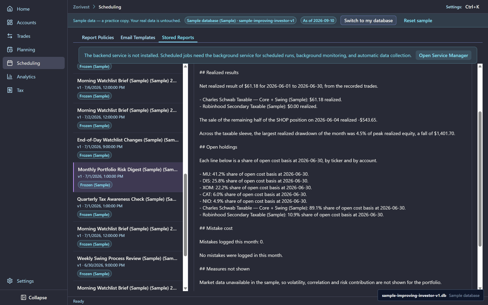<!-- from="reports-shot-list.md#17" -->

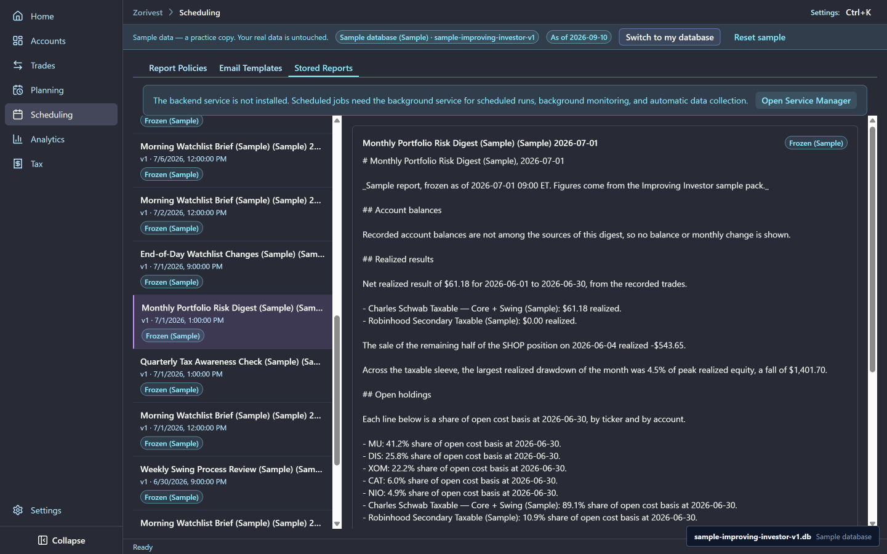<!-- from="reports-shot-list.md#18" -->

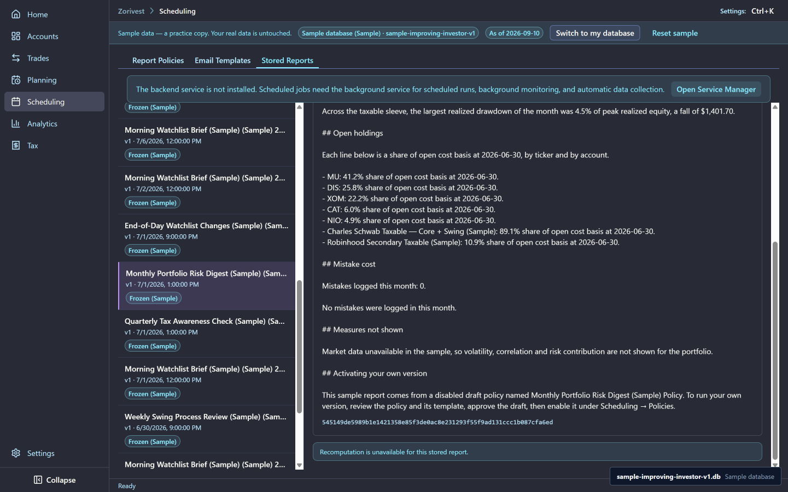<!-- from="reports-shot-list.md#19" -->

### Quarterly Tax Awareness Check

One quarterly check, srp-0018, for the second quarter of 2026: realized gains and losses, wash-sale adjustments, open lots with unrealized losses, the tax profile, and questions for a tax professional.

- Short-term realized $714.13 and long-term $0.00, from 9 round trips: Schwab $796.56 and Robinhood −$82.43. The Roth IRA is excluded.
- One wash-sale adjustment: the CAT lot ex-0097, loss realized 2026-06-15, $10.16 disallowed.
- No unrealized loss is shown, because the sample records no carrying value for open lots.
- Profile: single, Illinois, federal bracket 24%, state rate 4.95%, no carryforward recorded.

The report links two IRS pages for the rules and lists questions for a professional rather than giving advice. See [Tax and wash sales](06-tax-and-wash-sales.md).

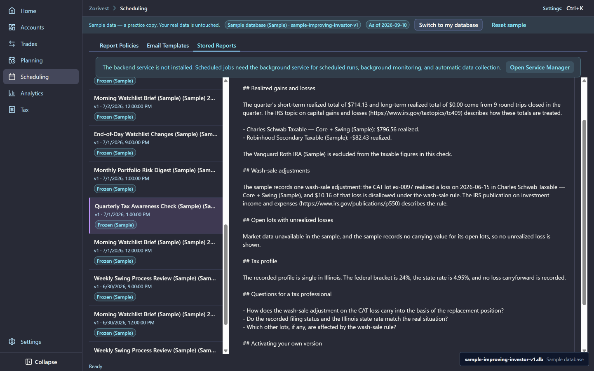<!-- from="reports-shot-list.md#20" -->

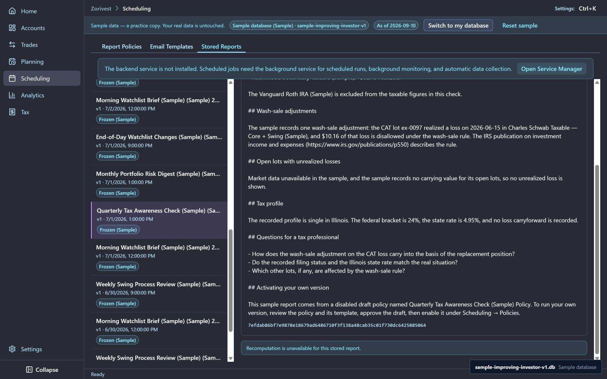<!-- from="reports-shot-list.md#21" -->

## Frozen and live labels

Under Scheduling, then Stored Reports, each row carries a label:

- `Frozen (Sample)`, in the cyan accent, for a sample report.
- `Live`, in the green accent, for a report your own policy stored.

The detail header repeats the label as a chip. With no report selected, the pane reads "Select a stored report from the list to view it."

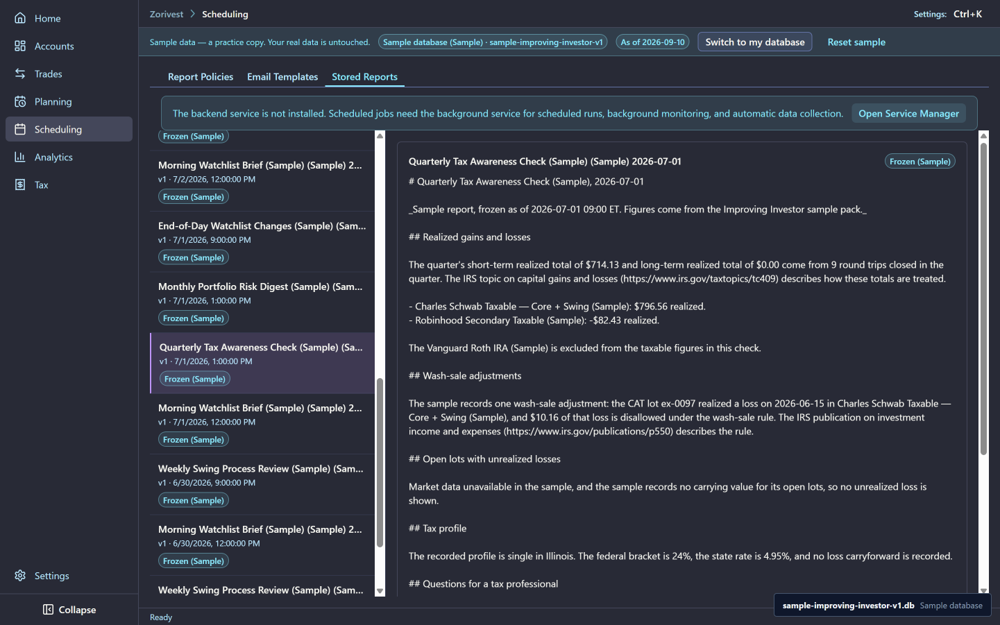<!-- from="reports-shot-list.md#23" -->

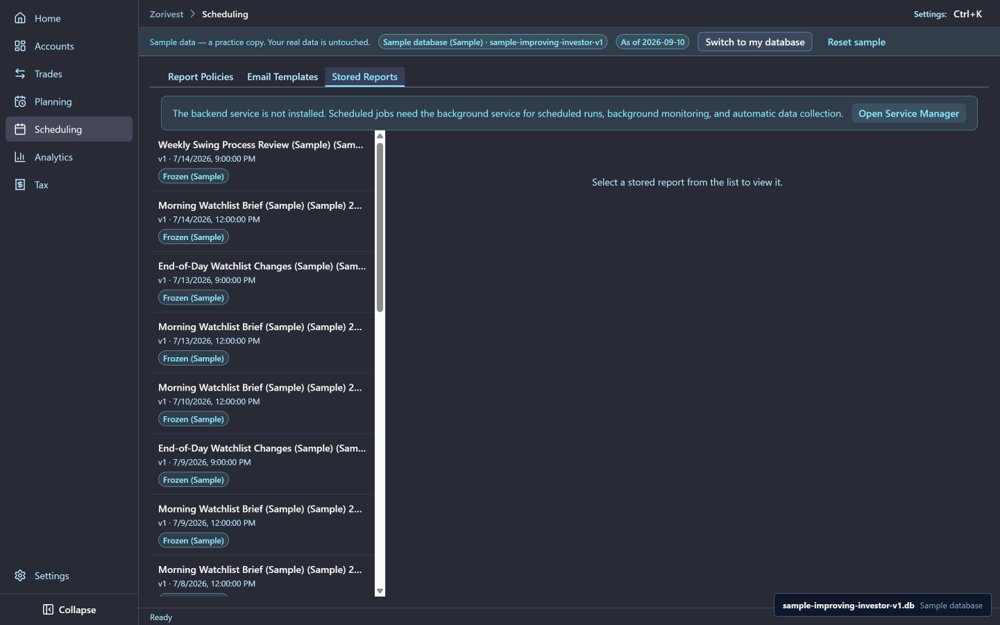<!-- from="reports-shot-list.md#24" -->

## Related

- [Activating your sample reports](09-activating-sample-reports.md) — produce a `Live` report of your own.
- [Analytics and evidence](07-analytics-and-evidence.md)
- [Drawdown](../reference/drawdown.md) and [Expectancy](../reference/expectancy.md)
- [Guide index](README.md)
