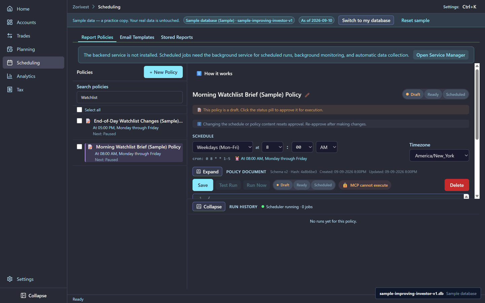
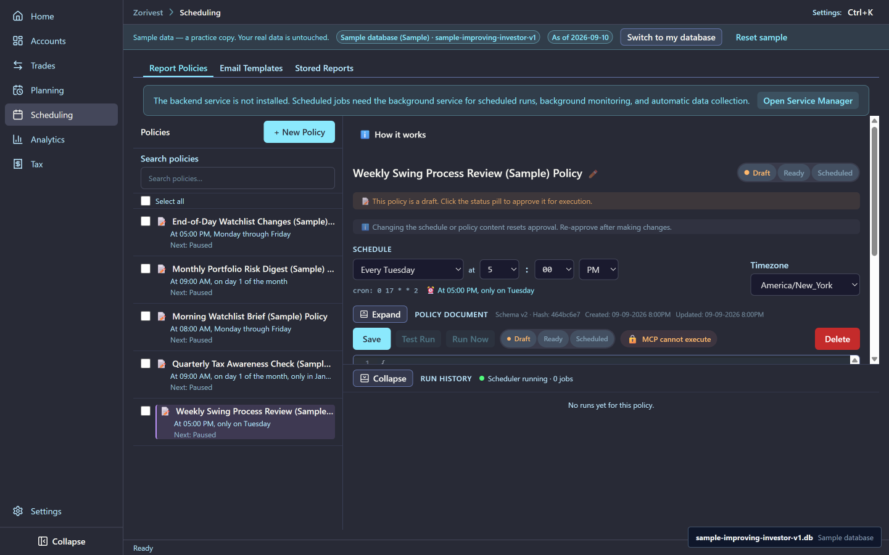
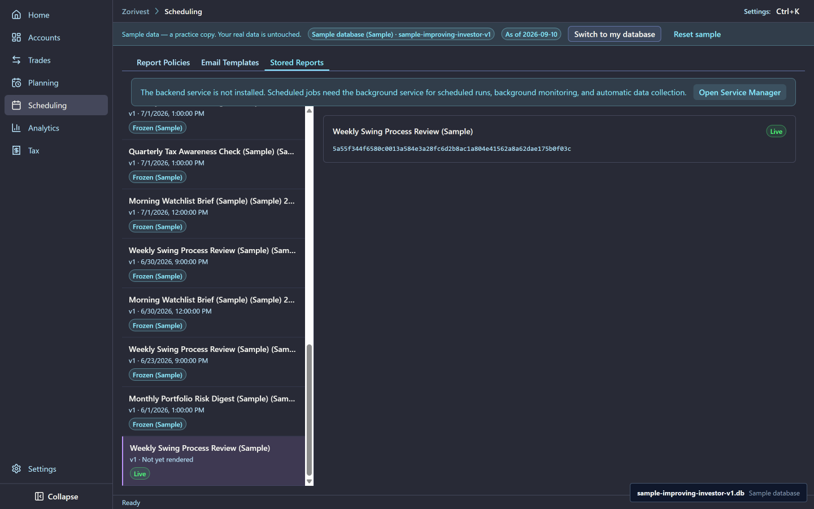
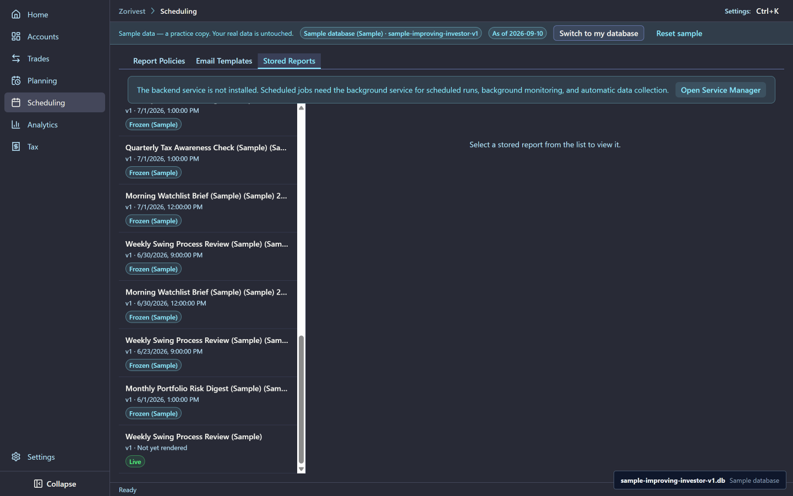

# Activating your sample reports

Every sample report comes with the policy that would produce it. All five policies arrive as drafts: not approved, not enabled, with the schedule off, no send step and no recipient. A draft never runs. This chapter turns one into a working policy and runs it once.

Synthetic sample data. Not affiliated with any named institution.

## The five sample policies

| Policy | What it stores |
|---|---|
| **Morning Watchlist Brief (Sample) Policy** | A morning brief over the watchlists |
| **End-of-Day Watchlist Changes (Sample) Policy** | The changes since the morning brief |
| **Weekly Swing Process Review (Sample) Policy** | The weekly process review |
| **Monthly Portfolio Risk Digest (Sample) Policy** | The monthly digest |
| **Quarterly Tax Awareness Check (Sample) Policy** | The quarterly tax check |

The two daily policies fetch market data, search the news and ask an AI model to draft the brief, so they need a market-data provider, a web-search provider and an AI provider before they can produce anything. The weekly, monthly and quarterly policies read only your journal, so they run with nothing else configured. This chapter uses the weekly review.

<!-- from="reports-shot-list.md#12" -->

<!-- from="reports-shot-list.md#22" -->

## The lifecycle

A policy moves through three states, shown in the status pill at the top of its detail pane:

- **Draft:** stored, but it cannot run.
- **Ready:** approved. It can run when you select Run Now, but its schedule is off.
- **Scheduled:** approved and enabled. It runs on its schedule.

Approving is a deliberate step: changing a policy's schedule or content returns it to Draft until you approve it again. A run stores a report and delivers nothing, because the sample policies have no send step. See [Cron expressions](../reference/cron-expressions.md) for reading a schedule, and the [Policy authoring guide](../guides/policy-authoring-guide.md) for writing your own.

## What you get

A report your policy stores is labelled `Live` under Scheduling, then Stored Reports, next to the sample's `Frozen (Sample)` reports. The detail header shows a `Live` chip. The frozen sample reports are never changed by a run.

<!-- from="reports-shot-list.md#25" -->

<!-- from="reports-shot-list.md#26" -->

## Make it operational

1. Open **Scheduling**, then the **Report Policies** tab, and select **Weekly Swing Process Review (Sample) Policy**; its status pill reads **Draft**. <!-- op: 09-activating-sample-reports-op-01 -->
2. Open the **Email Templates** tab and select **Weekly Swing Process Review (Sample)** to review the template the policy uses. <!-- op: 09-activating-sample-reports-op-02 -->
3. Back on the **Report Policies** tab, select the policy again and select **Ready** in its status pill to approve it. <!-- op: 09-activating-sample-reports-op-03 -->
4. Select **Scheduled** in the status pill to enable its schedule. <!-- op: 09-activating-sample-reports-op-04 -->
5. Select **Run Now**, then **Confirm Run**. <!-- op: 09-activating-sample-reports-op-05 -->
6. Open the **Stored Reports** tab and find the new report labelled `Live`, next to the sample's `Frozen (Sample)` reports. <!-- op: 09-activating-sample-reports-op-06 -->
7. To try a daily policy, add a market-data provider, a web-search provider and an AI provider in Settings, then repeat steps 1 to 5 with **Morning Watchlist Brief (Sample) Policy**. <!-- op: 09-activating-sample-reports-op-07 external=provider -->

## Related

- [Stored reports](08-stored-reports.md) — what each sample report contains.
- [Jinja2 templates](../reference/jinja2-templates.md)
- [Guide index](README.md)
