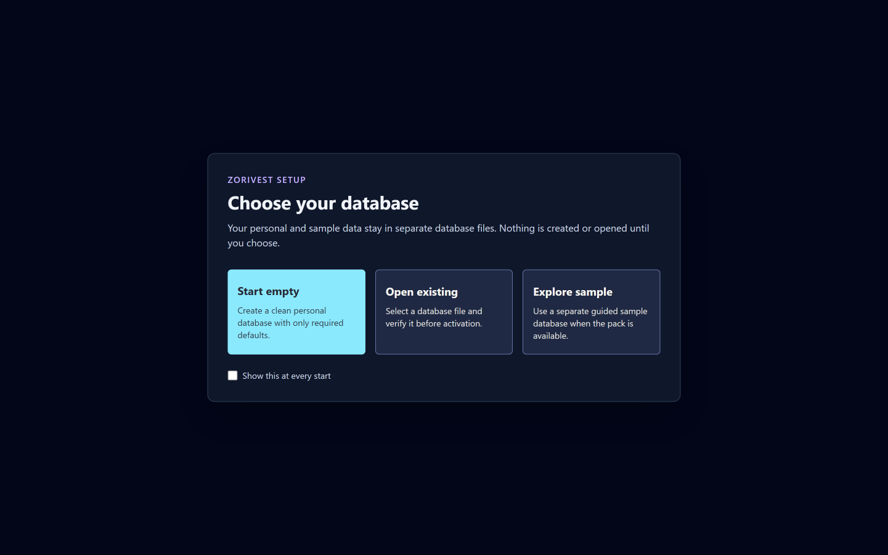
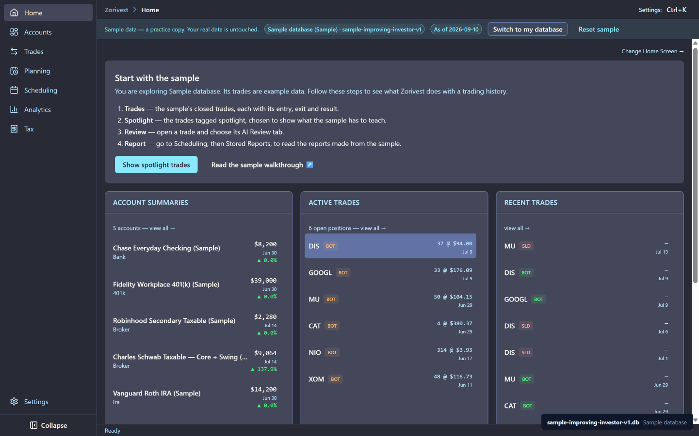
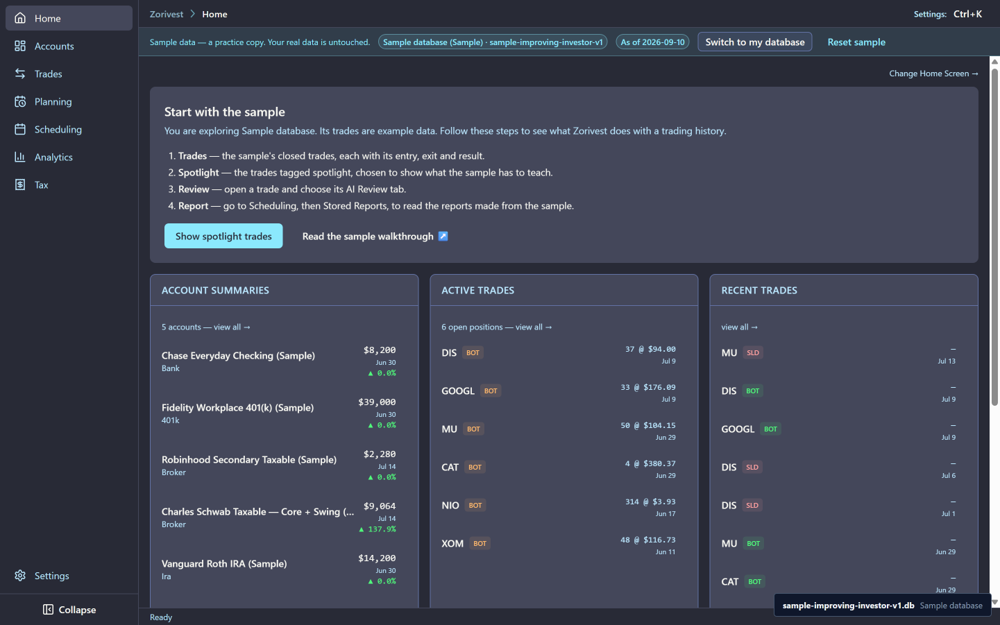
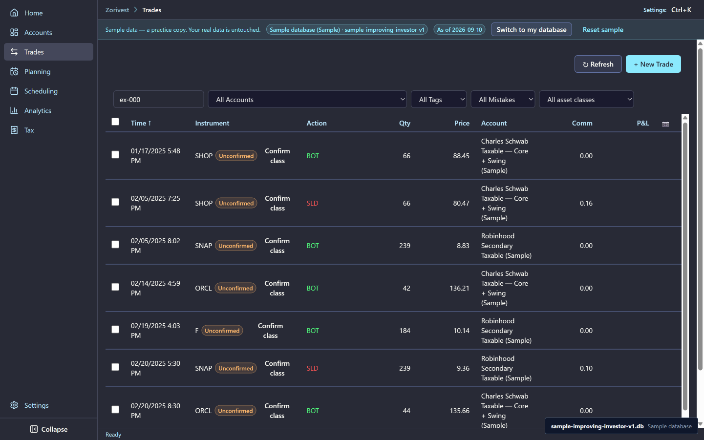
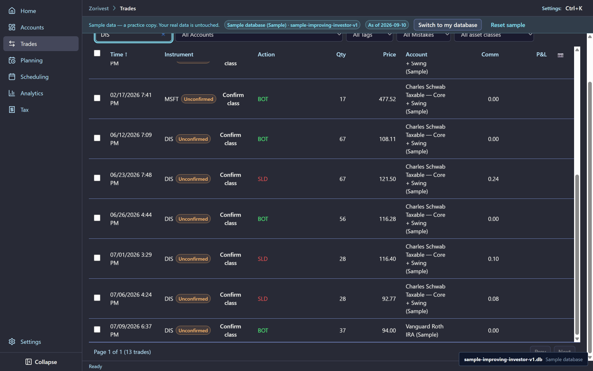
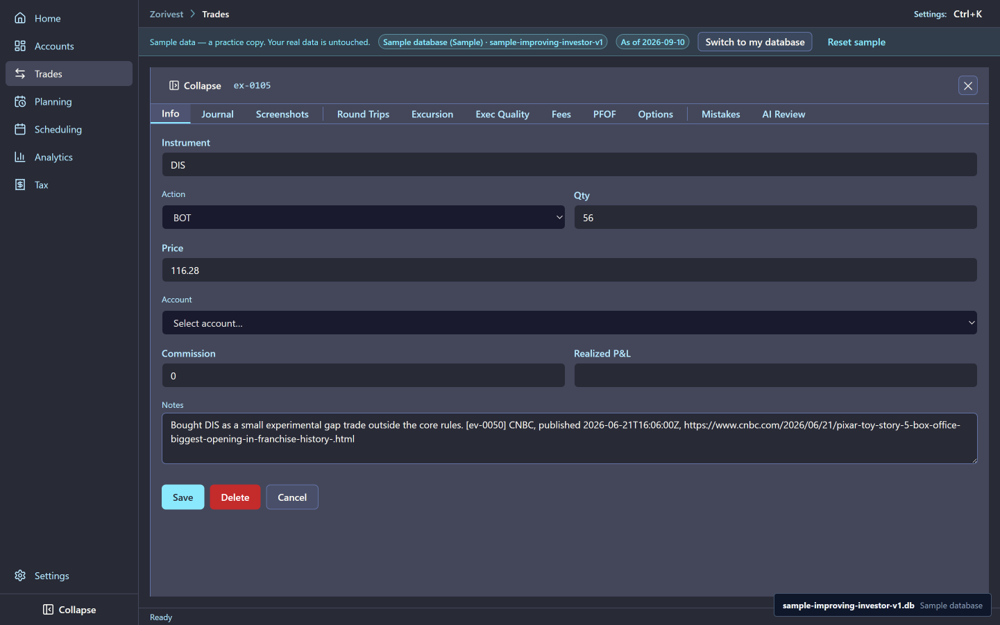
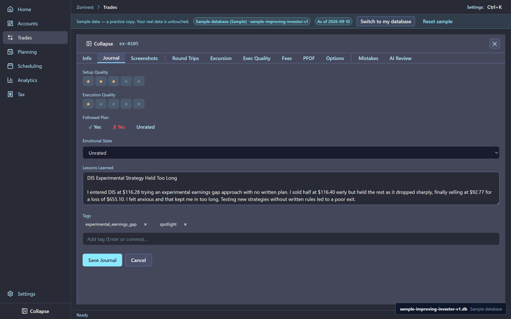
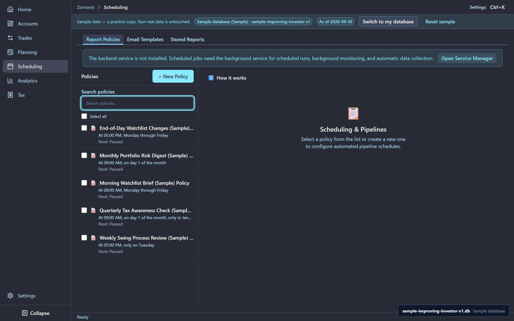
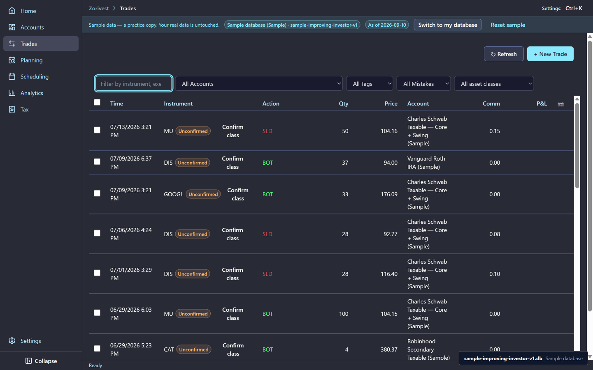

# The sample walkthrough

The Improving Investor is a fictional trader who gets better over a year. The sample holds that year as a ready-made Zorivest database. You can open it, read every screen, and change nothing in your own data.

Synthetic sample data. Not affiliated with any named institution.

## What the sample holds

| Record | Count |
|---|---|
| Accounts | 5 |
| Executions | 112 |
| Trade plans | 24 |
| Trade reports (the trader's own reviews) | 24 |
| Mistakes | 15 |
| Balance snapshots | 32 |
| Watchlists | 4, with 28 items |
| Tax profiles | 2 |
| Frozen AI reviews | 8 |
| Stored reports | 20 |
| Report templates | 5 |
| Report policies | 5 |
| Analytics scenarios | 11 |

The sample covers tax year 2025 and runs to an evidence cutoff of 2026-07-14. Its as-of date is 2026-09-10, and the sample does not age: dates in the app are the sample's own, not today's.

Two things are not in the sample on purpose:

- **No broker data.** There is no broker connection, credential, token or account number. The sample is a database, not a connection.
- **No market data.** There are no news fixtures and no daily price bars. Screens that need market data say that it is unavailable instead of showing a number.

## Open the sample

On a first launch, Zorivest asks you to choose a database. Select **Explore sample**. The app copies the sample into its own database and opens it, and the header's active database label reads `sample-improving-investor-v1.db`. If you close and reopen the app, it opens the same sample again without asking.

<!-- from="freeze-shot-list.md#1" -->

<!-- from="freeze-shot-list.md#2" -->

<!-- from="freeze-shot-list.md#11" -->

## A first tour

**The accounts.** Five accounts, each name ending in `(Sample)`: **Chase Everyday Checking (Sample)**, **Fidelity Workplace 401(k) (Sample)**, **Robinhood Secondary Taxable (Sample)**, **Charles Schwab Taxable — Core + Swing (Sample)** and **Vanguard Roth IRA (Sample)**. See [Accounts and plans](01-accounts-and-plans.md).

<!-- from="freeze-shot-list.md#12" -->

**The trades.** The first five executions are ex-0001 to ex-0005: SHOP, SHOP, SNAP, ORCL and F. DIS is held in two accounts, the Schwab taxable account and the Vanguard Roth IRA, and the trades list shows them as separate positions. See [Trades](02-trades.md).

<!-- from="freeze-shot-list.md#13" -->

<!-- from="freeze-shot-list.md#3" -->

**A spotlight trade and its journal.** Open the DIS trade on the Schwab account (TRIP-044). Its Info tab shows the legs, and its Journal tab holds the trader's own review of the trade. See [Spotlights and reviews](03-spotlights-and-reviews.md).

<!-- from="freeze-shot-list.md#4" -->

<!-- from="freeze-shot-list.md#5" -->

**A frozen AI review.** Trades with a stored review show it on the AI Review tab, labelled `Frozen (Sample)`. It reads the same with no AI provider configured. See [AI reviews](04-ai-reviews.md).

<!-- from="freeze-shot-list.md#6" -->

**Stored reports.** Scheduling, then Stored Reports, lists twenty reports, each labelled `Frozen (Sample)`. One of them, the 2026-07-08 morning brief (srp-0007), was written on a day the news provider was unavailable: it says what it could not fill and keeps every other section. See [Stored reports](08-stored-reports.md).

<!-- from="freeze-shot-list.md#7" -->

<!-- from="freeze-shot-list.md#8" -->

**Report policies.** Scheduling, then Report Policies, lists the five sample policies, each in Draft. A draft never runs on its own. See [Activating your sample reports](09-activating-sample-reports.md).

<!-- from="freeze-shot-list.md#9" -->

<!-- from="freeze-shot-list.md#14" -->

## Frozen and live

Every sample AI review, stored report and policy is marked as sample output, and the app labels it from that mark. You can read all of it offline. When you add your own AI provider or run your own policy, the new output is labelled `Live` and sits beside the frozen sample output, so the two are never confused.

## Make it operational

1. On the Choose your database screen, select **Explore sample**, and check that the active database label reads `sample-improving-investor-v1.db`. <!-- op: sample-walkthrough-op-01 -->
2. Open **Accounts** and find the five sample accounts, each name ending in `(Sample)`. <!-- op: sample-walkthrough-op-02 -->
3. Open **Scheduling**, then the **Stored Reports** tab, and check that the twenty reports are each labelled `Frozen (Sample)`. <!-- op: sample-walkthrough-op-03 -->
4. Open the **Report Policies** tab and check that the five sample policies are each in **Draft**. <!-- op: sample-walkthrough-op-04 -->

## Where to go next

Read [Accounts and plans](01-accounts-and-plans.md) next, or go back to the [guide index](README.md).
